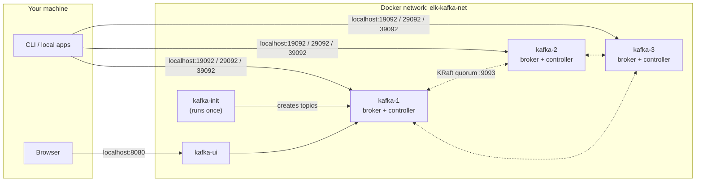

# A Kafka cluster from scratch, and what Kafka is for

*Step 01 of the ELK + Kafka + Grafana project · branch `step-01-kafka-init`*

This project builds a log and metrics pipeline one step at a time. Applications write to Kafka. Logstash moves the data into Elasticsearch. Kibana and Grafana show it. Step 01 lays the foundation: a running Kafka cluster with the topics the later steps need, operated entirely from the command line.

This article covers three things:

1. The Kafka ideas you need to follow the setup.
2. What was built in this step, and why each choice was made.
3. Where Kafka is used in practice, and where it isn't the right tool.

---

## 1. Kafka in five minutes

Kafka is a **distributed, append-only log**. Producers add records to the end. Consumers read them in order, each at its own pace. Records are not deleted when someone reads them. They stay until a retention limit is reached, so many independent readers can use the same data, and a reader can go back and read it again.

| Term | Meaning |
|------|---------|
| **Record** | One message: an optional key, a value, a timestamp and headers. |
| **Topic** | A named stream of records, such as `app-logs`. |
| **Partition** | A topic is split into partitions. Each partition is an ordered log, and order is guaranteed *within* a partition only. Records with the same key always go to the same partition. |
| **Offset** | A record's position in its partition. Consumers track how far they have read by storing offsets. |
| **Broker** | A Kafka server. It stores partitions and serves reads and writes. |
| **Replication** | Each partition is copied to several brokers. One copy is the **leader** and takes all reads and writes; the others are **followers**. |
| **ISR** (in-sync replicas) | The copies that are fully caught up with the leader. Only these can take over if the leader fails. |
| **Consumer group** | Consumers that share the work of reading a topic. Each partition goes to exactly one consumer in the group, so partitions limit how many consumers can work in parallel. |
| **KRaft** | Kafka's built-in way of electing a controller and storing cluster metadata. It replaced ZooKeeper, which Kafka 4.0 no longer supports. |

The main point: **partitions give you scale, replication gives you safety, and offsets let anyone re-read the data.**

---

## 2. What was built

### Architecture



| Piece | File | Role |
|-------|------|------|
| `kafka-1`, `kafka-2`, `kafka-3` | [docker-compose.yml](../docker-compose.yml) | Three nodes. Each is both a broker and a KRaft controller. |
| `kafka-init` | [scripts/create-topics.sh](../scripts/create-topics.sh) | Waits until the cluster is ready, creates the topics, then exits. |
| `kafka-ui` | [docker-compose.yml](../docker-compose.yml) | A web page for browsing topics, messages and consumer groups. |

Topics created:

| Topic | Partitions | Replication factor | Retention | Used by (later steps) |
|-------|-----------:|-------------------:|-----------|-----------------------|
| `app-logs` | 3 | 3 | 7 days | Logstash → Elasticsearch → Kibana |
| `app-metrics` | 3 | 3 | 7 days | Metrics pipeline → Grafana |
| `app-events` | 3 | 3 | 7 days | Business and audit events |

### Design decisions

**Three nodes, not one.** One broker is enough to send and receive messages, but it can't show replication, leader election or failover, and those are the ideas that matter most when running Kafka. Three is the smallest cluster where a controller majority (2 of 3) survives losing a node.

**KRaft, no ZooKeeper.** Kafka 4.0 removed ZooKeeper. Each node runs the broker and the controller in the same process (`KAFKA_PROCESS_ROLES: broker,controller`). That's fine for development. In production, controllers usually run on separate nodes. All three nodes share a fixed `CLUSTER_ID`, because a node only joins a cluster whose ID matches its own.

**Three listeners per node.** This is the part people most often get wrong when running Kafka in Docker. When a client connects, the broker sends back the *advertised* addresses of the brokers, and the client then connects to those addresses directly. Programs inside Docker and on your machine need different addresses, so each node has a separate listener for each:

| Listener | Port in container | Advertised as | Used by |
|----------|------------------|---------------|---------|
| `INTERNAL` | 9092 | `kafka-N:9092` | Other containers and replication between brokers |
| `EXTERNAL` | 9094 | `localhost:N9092` | Programs on your machine |
| `CONTROLLER` | 9093 | — | KRaft voting between nodes |

**Replication factor 3, `min.insync.replicas` 2.** Every partition is stored on all three brokers. A producer using `acks=all` gets a confirmation only after at least two copies have the record. Result: **one broker can go down without losing data or blocking writes.** If two go down, writes with `acks=all` are refused rather than accepted with too few copies.

**Automatic topic creation turned off.** By default, Kafka creates a topic the first time anyone writes to an unknown name, so a typo like `app-lgos` quietly becomes a new topic. Here, topics exist only if [create-topics.sh](../scripts/create-topics.sh) creates them. That makes the script the single list of topics, and it can be reviewed in git.

**Topic creation is a one-off container.** `kafka-init` waits until all three brokers pass their health checks (`depends_on: service_healthy`), then runs `kafka-topics.sh --create --if-not-exists` for each topic. Running it again changes nothing. `kafka-ui` waits for it with `service_completed_successfully`, so the UI never opens on an empty cluster.

**Three partitions per topic.** This allows up to three consumers in a group to read in parallel, one per broker, which is enough for a local setup. You can add partitions later but can never remove them. Adding them also changes which partition each key maps to.

**LF line endings for scripts.** [.gitattributes](../.gitattributes) keeps `*.sh` files in Linux format. Without it, Git on Windows can add CRLF line endings, and bash inside the container fails on the `\r` characters.

### Checking it

These checks passed on this branch:

```text
kafka-1      Up (healthy)
kafka-2      Up (healthy)
kafka-3      Up (healthy)
kafka-init   Exited (0)

Topic: app-logs  Partition: 0  Leader: 2  Replicas: 2,3,1  Isr: 2,3,1
Topic: app-logs  Partition: 1  Leader: 3  Replicas: 3,1,2  Isr: 3,1,2
Topic: app-logs  Partition: 2  Leader: 1  Replicas: 1,2,3  Isr: 1,2,3
```

Leaders are spread across all three brokers, and every replica is in sync. A message sent through `kafka-1` was read back through `kafka-2`. The KRaft quorum shows one leader and zero follower lag.

The commands for creating topics, sending and reading messages, consumer groups and a failover exercise are in the [README](../README.md).

---

## 3. Where Kafka is used

Kafka fits when **many systems need the same stream of data**, **producers and consumers run at different speeds**, or **the history must be kept and re-read**. Common uses:

### Log aggregation (this project)

Hundreds of services send logs to one topic. Kafka absorbs traffic spikes, so if Elasticsearch slows down or goes offline, logs build up in Kafka instead of being lost. Several consumers can read the same logs independently, for example Logstash for search, an archiver for cold storage and an alerting job.

→ `app-logs`, consumed by Logstash in a later step.

### Metrics and monitoring pipelines

Applications and agents publish measurements. Consumers combine them over time, store them in time-series databases and feed dashboards. Kafka separates the sources from where the data ends up, so a new metrics store can be added without touching the applications.

→ `app-metrics`, shown in Grafana in a later step.

### Event-driven microservices

Services announce facts, such as `OrderPlaced` or `PaymentCaptured`, instead of calling each other directly. Any service that cares subscribes. The sender doesn't need to know who listens, and a listener that is down catches up from its stored offset when it comes back. Using the order ID as the key keeps all events for one order in sequence.

→ `app-events`.

### Activity tracking

This is Kafka's original use case at LinkedIn. Page views, clicks and searches go into topics at very high volume and are consumed by analytics, recommendations and fraud detection.

### Change data capture (CDC)

Tools like Debezium read a database's internal change log and publish every insert, update and delete to Kafka. Search indexes, caches and data warehouses stay in sync with the database without the database writing to each of them (the "dual write" problem).

### Stream processing

Kafka Streams, Flink or ksqlDB read topics, then filter, join, add data or aggregate over time windows, and write the results to new topics. Examples: real-time fraud scores, live leaderboards, alerts on error-rate spikes.

### Data integration

Kafka Connect provides ready-made connectors to and from databases, S3, Elasticsearch and many SaaS tools. Kafka becomes the central hub, which replaces many direct system-to-system links.

### Event sourcing and audit trails

If every change is kept as an event, the current state can be rebuilt by replaying the log. Topics with long retention, or compacted topics (which keep only the latest value per key), act as a durable record of what happened.

### When *not* to use Kafka

- **Request/response.** If the caller waits for an answer, use HTTP or gRPC.
- **Small volume, simple job queues.** A database table, Redis or RabbitMQ is easier to run.
- **Per-message routing, priorities or delayed delivery.** Traditional message brokers handle these well; Kafka mostly doesn't.
- **Querying by field.** Kafka is a log, not a database. Read from it into something you can query, such as Elasticsearch, as this project does next.
- **Tiny teams with no one to run it.** A Kafka cluster needs operational care. A managed service or a simpler tool may be the better choice.

---

## Next step

Step 02 connects the first consumer: **Logstash** reads `app-logs` from `kafka-1:9092,kafka-2:9092,kafka-3:9092` over the shared `elk-kafka-net` network and writes the logs to **Elasticsearch**.
