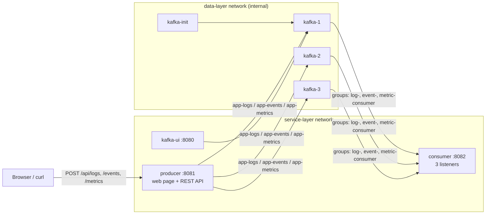

# Spring Boot producer and consumer for Kafka

*Step 02 of the ELK + Kafka + Grafana project · branch `step-02-producer-consumer`*

Step 01 left us with a three-broker Kafka cluster and three empty topics. Step 02 puts applications on both sides of it: a **producer** service that publishes logs, events and metrics, and a **consumer** service that reads them. Both are Spring Boot 4 apps in one Maven project, run in Docker on the same Compose stack as Kafka, and are configured on purpose rather than left on defaults.

This article covers:

1. [The big picture](#1-the-big-picture)
2. [Project layout](#2-project-layout)
3. [The producer and how it's customized](#3-the-producer)
4. [The consumer and how it's customized](#4-the-consumer)
5. [How the two agree on message types](#5-message-contracts-type-ids-instead-of-class-names)
6. [Docker images](#6-docker-images)
7. [Network layers](#7-network-layers)
8. [What we checked](#8-what-we-checked)
9. [Customizing further](#9-customizing-further)
10. [Lessons learned](#10-lessons-learned)

---

## 1. The big picture



A request reaches the producer, which turns it into a message and sends it to Kafka. The producer replies only after the brokers have stored the message, and the reply says exactly where it landed (`topic`, `partition`, `offset`). The consumer reads each topic in its own consumer group and logs every record with its position.

The brokers are the only containers on both networks. They sit between the service layer and the data layer.

---

## 2. Project layout

```text
springboot/
├── pom.xml                      parent: Spring Boot 4.1.2, Java 21, shared Kafka + Actuator deps
├── .dockerignore
├── producer/
│   ├── Dockerfile
│   ├── pom.xml                  + web, validation
│   └── src/main/
│       ├── java/.../producer/
│       │   ├── api/             PublishController, TopicController
│       │   ├── config/          TopicProperties
│       │   ├── model/           LogMessage, AppEvent, MetricMessage
│       │   ├── service/         KafkaPublisher
│       │   └── simulator/       TrafficSimulator
│       └── resources/
│           ├── application.yml
│           └── static/index.html    the producer web page
└── consumer/
    ├── Dockerfile
    ├── pom.xml                  + web (for /actuator/health only)
    └── src/main/
        ├── java/.../consumer/
        │   ├── config/          KafkaErrorConfig
        │   ├── listener/        LogListener, EventListener, MetricListener
        │   └── model/           LogMessage, AppEvent, MetricMessage
        └── resources/application.yml
```

**Why a parent POM?** Both services share the Spring Boot version, Java version and Kafka dependencies, so those are declared once. Each module adds only what it needs.

**Why no shared "common" module for the message classes?** Producer and consumer are meant to be deployed and changed independently, like separate teams' services. Each keeps its own copy of the message records. [Section 5](#5-message-contracts-type-ids-instead-of-class-names) shows how they still agree on the format.

---

## 3. The producer

### What it does

| Endpoint | Topic | Kafka key | Body |
|----------|-------|-----------|------|
| `POST /api/logs` | `app-logs` | `service` | `{service, level, message}` |
| `POST /api/events` | `app-events` | `aggregateId` | `{type, aggregateId, payload}` |
| `POST /api/metrics` | `app-metrics` | `service` | `{service, name, value, tags}` |
| `GET /api/topics` | — | — | Topic list for the web page |

Requests are validated with Bean Validation (`@NotBlank`, `@NotNull`, and a pattern for log levels), so bad input gets a `400` before anything is sent to Kafka. The producer adds the `id`, `timestamp` and, for logs, a `traceId`.

A successful call returns `202 Accepted` with the record's position:

```json
{"id":"e7ef8e5f-...","topic":"app-logs","partition":2,"offset":0}
```

### Customization 1: delivery guarantees

From [producer/application.yml](../springboot/producer/src/main/resources/application.yml):

```yaml
spring.kafka.producer:
  acks: all
  properties:
    enable.idempotence: true
    linger.ms: 5
```

| Setting | Value | Why |
|---------|-------|-----|
| `acks` | `all` | The leader confirms a write only after every in-sync replica has it. The topics have `min.insync.replicas=2`, so an acknowledged record exists on at least two brokers and survives losing one. |
| `enable.idempotence` | `true` | If a send is retried after a network glitch, the broker drops the duplicate. Combined with `acks=all`, this gives exactly-once delivery *per partition* from this producer. |
| `linger.ms` | `5` | Wait up to 5 ms to group records into one batch. Under load this means fewer, larger requests; with light traffic the delay is barely noticeable. |

### Customization 2: keys decide ordering

[KafkaPublisher](../springboot/producer/src/main/java/io/github/olgunyldz/producer/service/KafkaPublisher.java) chooses a key for every record:

```java
public CompletableFuture<SendResult<String, Object>> publish(AppEvent event) {
    return send(topics.events(), event.aggregateId(), event);
}
```

Kafka sends all records with the same key to the same partition, and a partition is strictly ordered. So:

- All events for `order-42` are consumed in the order they happened: placed → paid → shipped.
- All logs from `payment-service` stay in time order.

The trade-off is spread. With only a few distinct keys, some partitions get more traffic than others. The web page's *Records per partition* chart shows this: `app-events`, with 50 order ids, spreads evenly, while `app-logs`, with 5 service names, does not.

### Customization 3: the API waits for the broker

The controller returns a `CompletableFuture` instead of blocking a thread:

```java
return publisher.publish(message).thenApply(result -> toResponse(message.id(), result));
```

Spring MVC completes the HTTP response when Kafka acknowledges the record. The caller therefore knows the record is stored and replicated, not just queued in memory.

### Customization 4: topic names come from configuration

```yaml
app.kafka.topics:
  logs: app-logs
  events: app-events
  metrics: app-metrics
```

These bind to a [`TopicProperties`](../springboot/producer/src/main/java/io/github/olgunyldz/producer/config/TopicProperties.java) record. Code never hard-codes a topic name, and an environment can rename topics without a rebuild, for example `APP_KAFKA_TOPICS_LOGS=staging-logs`.

### The web page

Open http://localhost:8081. The page ([index.html](../springboot/producer/src/main/resources/static/index.html)) is a single static file with no external libraries:

- **Topic dropdown**, loaded from `GET /api/topics`.
- **Sample data per topic:** choosing a topic fills the body with a realistic example. *New sample* generates another one, and the body can be edited by hand.
- **Number of requests** (up to 10,000) and **In parallel** (up to 50).
- **New random data for each request**, or the same body every time.
- **Live results:** sent, acknowledged, failed, requests per second, records per partition, and the latest responses as `topic-partition@offset`.

It's a quick way to load the cluster and *see* partitioning and keys at work.

### The traffic simulator

[TrafficSimulator](../springboot/producer/src/main/java/io/github/olgunyldz/producer/simulator/TrafficSimulator.java) publishes one log and one order event per second when `SIMULATOR_ENABLED=true`. Log levels are weighted roughly 70% INFO, 15% DEBUG, 10% WARN, 5% ERROR, which gives the later Kibana and Grafana steps realistic data. The class is only created when the property is on (`@ConditionalOnBooleanProperty`), so it costs nothing when off.

---

## 4. The consumer

### What it does

| Listener | Topic | Consumer group | Threads |
|----------|-------|----------------|---------|
| [LogListener](../springboot/consumer/src/main/java/io/github/olgunyldz/consumer/listener/LogListener.java) | `app-logs` | `log-consumer` | 3 |
| [EventListener](../springboot/consumer/src/main/java/io/github/olgunyldz/consumer/listener/EventListener.java) | `app-events` | `event-consumer` | 3 |
| [MetricListener](../springboot/consumer/src/main/java/io/github/olgunyldz/consumer/listener/MetricListener.java) | `app-metrics` | `metric-consumer` | 3 |

Each listener receives a full `ConsumerRecord`, not just the value, so it can log where the record came from:

```text
[app-events-0@21] OrderPlaced order-42 {amount=99}
```

### Customization 1: one group per topic

Each listener has its own `groupId`. Kafka tracks offsets per group, so:

- If metric handling falls behind, log handling is unaffected.
- `kafka-consumer-groups.sh --describe --group log-consumer` shows the lag of exactly one stream.
- A future consumer, such as Logstash in step 03, can read `app-logs` in *its own* group and receive every record too. Groups don't take records from each other.

### Customization 2: concurrency matches partitions

```java
@KafkaListener(topics = "${app.kafka.topics.logs}", groupId = "log-consumer", concurrency = "3")
```

Each topic has 3 partitions, and within a group each partition goes to exactly one consumer. Three threads means one per partition, which is the most parallelism a group can use. A fourth thread would sit idle. Startup logs show the assignment:

```text
log-consumer: partitions assigned: [app-logs-0]
log-consumer: partitions assigned: [app-logs-1]
log-consumer: partitions assigned: [app-logs-2]
```

### Customization 3: where a new group starts

```yaml
spring.kafka.consumer.auto-offset-reset: earliest
```

A group with no saved offsets starts from the oldest record still in the topic, instead of only seeing new ones. Nothing published before the consumer first started is missed. After that, the group resumes from its committed offsets, so a restart neither replays everything nor skips anything.

### Customization 4: bad records can't block a partition

A record that can't be parsed is called a *poison pill*. Without protection, the consumer fails on it, retries, fails again, and that partition stops moving forever. Two layers prevent this.

**Layer 1: deserialization errors are caught.**

```yaml
value-deserializer: org.springframework.kafka.support.serializer.ErrorHandlingDeserializer
properties:
  spring.deserializer.value.delegate.class: org.springframework.kafka.support.serializer.JacksonJsonDeserializer
```

`ErrorHandlingDeserializer` wraps the JSON deserializer. If JSON parsing fails, it catches the exception and passes the failure on as data, so the poll loop keeps running.

**Layer 2: failures are retried, then skipped.** [KafkaErrorConfig](../springboot/consumer/src/main/java/io/github/olgunyldz/consumer/config/KafkaErrorConfig.java):

```java
@Bean
DefaultErrorHandler kafkaErrorHandler() {
    return new DefaultErrorHandler(
            (record, ex) -> log.error("Skipping {}-{}@{} after retries: {}", ...),
            new FixedBackOff(1000L, 3));
}
```

A failing record is retried 3 times, 1 second apart, then logged and skipped. Deserialization errors are never retried, because the bytes won't change. Spring Boot picks up this bean automatically and applies it to every listener.

When we wrote `not json` to `app-logs` by hand, the result was:

```text
ERROR KafkaErrorConfig : Skipping app-logs-2@1 after retries: Listener failed
INFO  LogListener      : [app-logs-2@2] ... WARN order-service: after the bad one
```

The bad record was skipped, and the next one was processed straight away.

---

## 5. Message contracts: type ids instead of class names

By default, Spring Kafka's JSON serializer writes the **full Java class name** into a `__TypeId__` header, and the deserializer creates that exact class. That would tie the consumer to the producer's package names.

We map short **type ids** on both sides instead:

```yaml
# producer
spring.json.type.mapping: "log:io.github.olgunyldz.producer.model.LogMessage,event:...producer.model.AppEvent,metric:...producer.model.MetricMessage"

# consumer
spring.json.type.mapping: "log:io.github.olgunyldz.consumer.model.LogMessage,event:...consumer.model.AppEvent,metric:...consumer.model.MetricMessage"
spring.json.trusted.packages: io.github.olgunyldz.consumer.model
```

A record on the wire then looks like this:

```text
headers:  __TypeId__ = event
key:      order-42
value:    {"id":"83c9...","timestamp":"2026-10-29T17:35:16Z","type":"OrderPlaced","aggregateId":"order-42","payload":{"amount":99}}
```

The contract is the **type id plus the JSON fields**. Either side can rename or move its classes freely. `trusted.packages` limits which classes the consumer will ever create from incoming data, which protects against untrusted type headers.

> **Spring Boot 4 note:** Spring Kafka 4 uses Jackson 3. The serializer classes are `JacksonJsonSerializer` and `JacksonJsonDeserializer`; the older `JsonSerializer` and `JsonDeserializer` still exist but are deprecated. The `spring.json.*` property names didn't change. `java.time.Instant` works without extra modules.

---

## 6. Docker images

Each module has its own Dockerfile ([producer](../springboot/producer/Dockerfile), [consumer](../springboot/consumer/Dockerfile)) in three stages:

```text
1. build    maven:3.9-eclipse-temurin-21   mvn -pl producer -am package
2. extract  eclipse-temurin:21-jre          java -Djarmode=tools -jar application.jar extract --layers
3. runtime  eclipse-temurin:21-jre          copy layers, run as user "spring"
```

| Choice | Why |
|--------|-----|
| Build context is `springboot/`, not the module folder | A module can't build without its parent POM. Each Dockerfile copies every module's `pom.xml` (Maven checks that all listed modules exist) but only its own `src`. |
| `--mount=type=cache,target=/root/.m2` | Dependencies downloaded once are reused by later builds. |
| Layered jar | Dependencies, the Spring Boot loader and our classes become separate image layers. A code change rebuilds only the small application layer. |
| JRE, not JDK, at runtime | No compiler or Maven in the final image. |
| Non-root user `spring` | A compromised app doesn't get root in the container. |
| `-XX:MaxRAMPercentage=75` | The JVM sizes its heap from the container's memory limit, not the host's. |

Compose builds both images, starts them only after `kafka-init` has created the topics (`service_completed_successfully`), and marks them healthy once `GET /actuator/health` succeeds.

---

## 7. Network layers

| Network | Members | Purpose |
|---------|---------|---------|
| `data-layer` | `kafka-1..3`, `kafka-init` | Controller voting, replication, topic setup. `internal: true`, so it has no route to the internet. |
| `service-layer` | `kafka-1..3`, `producer`, `consumer`, `kafka-ui` | Applications that read from and write to Kafka |

The brokers are the only containers on both networks. Services reach Kafka through `service-layer`; traffic between the brokers stays on `data-layer`. Published ports still work because they go through `service-layer`.

The layering matters more as the stack grows. Elasticsearch will join `data-layer`, Logstash and Grafana will join `service-layer`, and the rule stays simple: **stores live in the data layer, and everything that runs logic or a UI lives in the service layer.**

---

## 8. What we checked

| Check | Result |
|-------|--------|
| `mvn package` for both modules | Builds |
| Log, event and metric sent with curl | Consumed, with the right topic, partition and offset |
| Invalid log level or missing metric value | `400`, nothing sent to Kafka |
| `not json` written to `app-logs` | Skipped after retries; the next record processed normally |
| Simulator on for 20 seconds | Steady flow; `log-consumer` lag 0 |
| Web page: 50 `app-events` requests, 5 in parallel | 50/50 acknowledged, ~350 req/s, split 11 / 23 / 16 across partitions |
| Docker images | Build; run as `uid=999(spring)`; healthy |
| Network layers | Services reach `kafka-1:9092`; `data-layer` can't reach the internet; host ports work |

---

## 9. Customizing further

### Adding a new message type

Suppose we add `app-audit`:

1. **Topic:** add `"app-audit:3:3"` to [scripts/create-topics.sh](../scripts/create-topics.sh). Automatic topic creation is off, so this step is required.
2. **Producer:** add a model record, a `publish(...)` overload, an endpoint and the topic name in `app.kafka.topics`. Add `audit:...AuditMessage` to `spring.json.type.mapping`.
3. **Web page:** add an entry to `TopicController` and a generator under `samples` in `index.html`.
4. **Consumer:** add a model record and a listener with its own `groupId`, and add `audit:...AuditMessage` to the consumer's type mapping.

### Producer settings worth knowing

| Setting | Default | When to change |
|---------|---------|----------------|
| `linger.ms` | 5 here | Raise to 20–100 for higher throughput, at the cost of latency. |
| `batch.size` | 16 KB | Raise together with `linger.ms` for high volume. |
| `compression.type` | none | `lz4` or `zstd` for JSON logs often shrinks network and disk use several times. |
| `max.block.ms` | 60 s | How long `send()` waits when the brokers are unreachable. We saw requests hang for a full minute while the cluster was down; lower it so the API fails fast. |
| `delivery.timeout.ms` | 120 s | Upper limit on retries for one record. |

### Consumer settings worth knowing

| Setting | Default | When to change |
|---------|---------|----------------|
| `concurrency` | 3 here | Keep it at most the partition count. More partitions are needed for more parallelism. |
| `max.poll.records` | 500 | Lower it if processing each record is slow, so a poll finishes within `max.poll.interval.ms`. |
| `max.poll.interval.ms` | 5 min | A consumer that takes longer between polls is considered dead, and its partitions move to another consumer. |
| `FixedBackOff(1000, 3)` | — | Use `ExponentialBackOff` for flaky downstream systems. |
| Recoverer | log and skip | Swap in `DeadLetterPublishingRecoverer` to send failed records to an `app-logs.DLT` topic so they can be inspected or replayed instead of lost. |

---

## 10. Lessons learned

- **Spring Boot 4 split up the starters.** Use `spring-boot-starter-kafka` and `spring-boot-starter-webmvc`, and expect Jackson 3 class names (`tools.jackson`, `JacksonJson*`).
- **Folded YAML strings add spaces.** A `>-` block for `spring.json.type.mapping` puts spaces after the commas, so keep the mapping on one line.
- **Kafka in Docker needs two addresses.** Containers use `kafka-1:9092`; the host uses `localhost:19092`. The apps read `KAFKA_BOOTSTRAP_SERVERS`, so the same jar runs in both places.
- **A down cluster looks like a slow API, not an error.** Without a lower `max.block.ms`, requests wait 60 seconds before failing.
- **Git Bash rewrites container paths.** `docker exec kafka-1 /opt/kafka/bin/...` needs `MSYS_NO_PATHCONV=1` in Git Bash on Windows; PowerShell doesn't.

---

## Next step

Step 03 adds the first store in the data layer: **Elasticsearch**, fed by **Logstash** reading `app-logs` in its own consumer group, with **Kibana** for searching the logs our producer generates.
