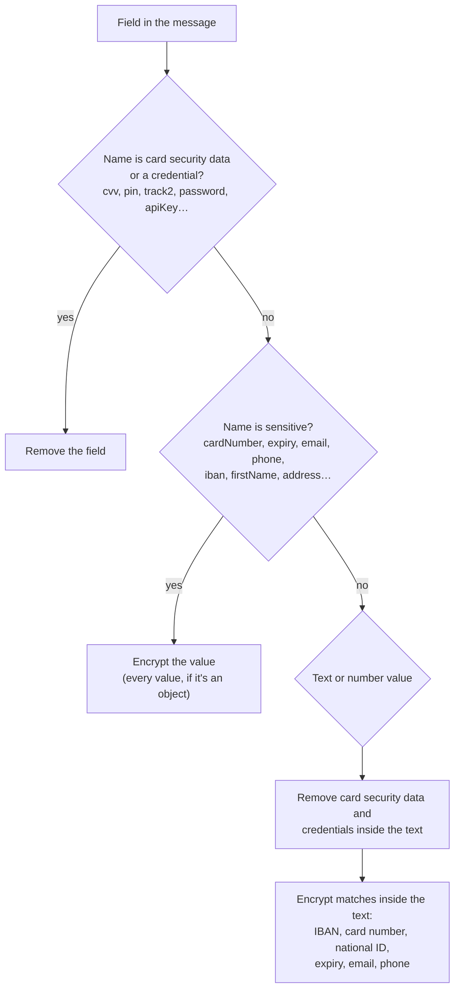

# Protecting card and personal data in Kafka

*Step 03 of the ELK + Kafka + Grafana project · branch `step-03-protect-kafka-data`*

**Goal:** no card or personal data readable in Kafka.

Kafka keeps every record for days, copies it to three brokers, and lets any client with network access read it: `kafka-ui`, a console consumer, and soon Logstash and Elasticsearch. If a card number gets in, it is in all of those places. Step 03 makes sure it never gets in readable: the producer removes or encrypts sensitive data **before** a record leaves the service, and only the consumer groups we choose can turn it back into plain text.

> **Not done yet: logs.** The apps still log with plain SLF4J `LoggerFactory` loggers. The consumer decrypts records for its own groups and logs them, so **its log output contains card numbers and personal data in plain text**. Step 06 adds log masking to fix that. Until then, treat the app logs as sensitive.

This article covers:

1. [What counts as sensitive](#1-what-counts-as-sensitive)
2. [How a message is protected](#2-how-a-message-is-protected): removal, encryption, keys
3. [The key](#3-the-key)
4. [The library and its beans](#4-the-library-log-masking)
5. [What changed in the apps](#5-what-changed-in-the-apps)
6. [Corrections to the step 02 article](#6-corrections-to-the-step-02-article)
7. [What we checked](#7-what-we-checked)
8. [Limits](#8-limits)

---

## 1. What counts as sensitive

| Category | Examples | Rule source | What we do |
|----------|----------|-------------|------------|
| **Card security data** (PCI DSS "sensitive authentication data") | CVV/CVC/CID, PIN, PIN block, magnetic stripe (track 1/2) data | PCI DSS 3.3: must not be stored after authorization, *even encrypted* | **Remove** |
| **Credentials** | Passwords, secrets, API keys, access/refresh tokens, `Authorization: Bearer …` | No reader ever needs them from a message | **Remove** |
| **Card data** | Card number (PAN), card expiry date | PCI DSS 3.5: must be unreadable wherever it is stored | **Encrypt** |
| **Personal data** | Name, email, phone, address, birth date, national ID (TCKN), IBAN | GDPR / KVKK: protect, and limit who can read it | **Encrypt** |
| Everything else | Amounts, currencies, order ids, service names, metrics | — | Leave as is |

Why **remove** card security data and credentials instead of encrypting them? PCI DSS is explicit that CVV, PIN and track data may not be kept in any form after authorization, and encrypted data is still stored data. For credentials, there is no legitimate reader: no consumer should log in with a password it found in a Kafka message.

Why **encrypt** the rest instead of masking (`411111******1111`) or hashing? Masking and hashing can't be undone, but some consumers legitimately need the real value: a refund service needs the IBAN, a support tool needs the customer's email. Encryption keeps the value usable for those consumers, and only for them.

---

## 2. How a message is protected

`SensitiveDataDetector` turns the message into a JSON tree and walks every part of it. Each field goes through these checks in order:



### Parts of a message

| Part | Example input | Sent to Kafka |
|------|---------------|---------------|
| Card security field | `"cvv": "737"` | field removed |
| Credential field | `"password": "S3cret!"`, `"session": {"accessToken": "…"}` | field removed |
| Card security data in text | `"…cvc=999 … pin=4321"` | `"…cvc=[REMOVED] … pin=[REMOVED]"` |
| Credential in text | `"Authorization: Bearer eyJhbGci…"` | `"Authorization: [REMOVED]"` |
| Card number field | `"number": "5555555555554444"` | `"number": "pan:v1:4444:…"` |
| Expiry field | `"expiry": "03/28"` | `"expiry": "exp:v1::…"` |
| Email, phone fields | `"email": "jane.doe@example.com"` | `"email": "email:v1:example.com:…"` |
| Other personal fields | `"holderName": "Jane Doe"` | `"holderName": "pii:v1::…"` |
| Personal object | `"address": {"street": "…", "city": "…"}` | every value inside encrypted |
| Card number anywhere | `"ref": 4111111111111111` (even a JSON number) | `"ref": "pan:v1:1111:…"` |
| Data in free text | `"…Mastercard 5555-5555-5555-4444 expiry=03/28 … mobile 0532 123 45 67"` | `"…Mastercard pan:v1:4444:… expiry=exp:v1::… … mobile phone:v1:67:…"` |
| Ordinary data | `"amount": 129.9`, `"name": "cpu_usage_percent"` | unchanged |

### Keeping false positives low

A long number isn't automatically a card number. To count as one, a value must:

1. have 13–19 digits (spaces or dashes between them are allowed),
2. start with a real card network prefix (Visa `4`, Mastercard `51–55`/`2221–2720`, Amex `34`/`37`, Troy `9792`, …), and
3. pass the **Luhn** check digit.

IBANs must pass the **mod-97** check, and Turkish national IDs the **TCKN** check digits. These checks are in `Checksums`. The control sample proves it: `order 4111111111111112 shipped at 1793271793911, ref 12345678901` is sent unchanged. The first number fails Luhn, the second is a timestamp with no card prefix, and the third fails the TCKN check.

Phones are found in free text in two forms: international (`+90 532 123 45 67`) and Turkish mobile (`0532 123 45 67`, `532-123-4567`). Other local formats are only found in fields named `phone`, `mobile` or `gsm`.

### Removal

`SensitiveAuthenticationData` knows the field names (compared ignoring case, `_` and `-`) and the text patterns:

| Kind | Field names | In text | Becomes |
|------|-------------|---------|---------|
| CVV | `cvv`, `cvc2`, `cid`, `securityCode`, … | `CVV: 123`, `cvc=999`, `"cvv":123` | `CVV: [REMOVED]`, `"cvv":"[REMOVED]"` |
| PIN | `pin`, `pinBlock`, `pinCode` | `pin=4321` | `pin=[REMOVED]` |
| Track data | `track1`, `track2`, `trackData`, `magstripe` | `%B4111…^DOE/JOHN^2512…?`, `;4111…=2512…?` | `[REMOVED]` |
| Credentials | `password`, `pwd`, `secret`, `clientSecret`, `apiKey`, `accessToken`, `refreshToken`, `token`, `authorization` | `password=S3cret!`, `Authorization: Bearer eyJ…` | `password=[REMOVED]` |

A removed field is gone from the record. In text, the **key stays** and only the value becomes `[REMOVED]`, so a reader can see what was taken out. In JSON-like text with an unquoted value, the replacement is quoted, so `{"cvv":123}` becomes valid `{"cvv":"[REMOVED]"}`. A full stop after a value is kept: `cvv2: 7788.` becomes `cvv2: [REMOVED].`

### Encryption

`SensitiveDataEncryption` uses **AES-256-GCM** and turns each value into a typed token with a readable hint:

```text
pan:v1:4444:awbnPFOL85sIFVZlMXRtTgaWBaE82DkpvKkUPhL5-uqCAi_Z4Ox-nCzmceVnM1A
│   │  │    └─ base64url( 12-byte IV | ciphertext | 16-byte tag )
│   │  └─ hint: readable without the key
│   └─ key version
└─ type
```

| Data | Token | Hint |
|------|-------|------|
| Card number | `pan:v1:1111:…` | last 4 digits, which PCI DSS allows to be shown |
| IBAN | `iban:v1:TR1326:…` | country and last 4 |
| National ID | `tckn:v1:46:…` | last 2 digits |
| Card expiry | `exp:v1::…` | none |
| Email | `email:v1:example.com:…` | domain |
| Phone | `phone:v1:67:…` | last 2 digits |
| Other personal data | `pii:v1::…` | none |

| Property | Why it matters |
|----------|----------------|
| Hint | Support staff, and later Kibana searches, can tell values apart ("the card ending 4444", "customers at example.org") without the key. |
| Type and hint are authenticated (GCM additional data) | Changing the hint, the type, or moving a payload to another token makes decryption fail, so a hint can't be faked. |
| Random IV for every value | The same card number encrypts differently every time, so nobody can spot repeated cards by comparing tokens. |
| GCM authentication tag | A changed token fails to decrypt instead of producing wrong data. |
| No spaces in the token | A token can sit inside a longer text and still be found and decrypted. |
| `v1` version | Leaves room for a new key later (`v2`) while old records still decrypt. |
| Existing tokens are skipped | Protecting a message twice changes nothing. |

### Kafka keys

A Kafka key decides the partition, so the same key must always produce the same bytes. An encrypted key with a random IV would scatter one customer's records across partitions and break their ordering. Keys therefore can't be encrypted. Instead, `PciKafkaTemplate` **rejects** a key that contains card or personal data:

```text
POST /api/events {"aggregateId": "4111111111111111", ...}
→ 400 Kafka key must not contain card number; use a non-sensitive id as the key
```

Use an id such as `order-1001` or `customer-77` as the key.

---

## 3. The key

Both apps read the same AES key:

```yaml
pci:
  data-encryption-key: ${DATA_ENCRYPTION_KEY:+WpfE866Ysy6Lp51Q61eBAcupVyUtI5nnyxwm6avujc=}
```

Compose sets `DATA_ENCRYPTION_KEY` for both containers from a shared `x-pci-env` block:

```yaml
x-pci-env: &pci-env
  DATA_ENCRYPTION_KEY: ${DATA_ENCRYPTION_KEY:-+WpfE866Ysy6Lp51Q61eBAcupVyUtI5nnyxwm6avujc=}
```

> **This is a public lab key.** It's committed to the repo so the lab works out of the box, which means anyone can decrypt data encrypted with it. Never use it for real data.

For anything real:

```bash
# Generate a 256-bit key (or call SensitiveDataEncryption.newBase64Key())
openssl rand -base64 32

# Give it to Compose without committing it: .env is git-ignored
echo "DATA_ENCRYPTION_KEY=<your key>" > .env
docker compose up -d
```

In production, the key belongs in a secret manager (Vault, AWS KMS / Secrets Manager, Kubernetes Secrets), not in a file, and only the services that need the data get it.

The apps **refuse to start** without a valid key: it must be set, must be base64, and must decode to exactly 32 bytes. Starting with a random key instead would silently produce data that no other service, and not even this one after a restart, can decrypt.

Changing the key makes older records unreadable with the new key. The `v1` in every token exists so a later step can add key rotation: new records use `v2`, and old `v1` records still decrypt with the old key.

---

## 4. The library: `log-masking`

The protection lives in a new Maven module, [springboot/log-masking](../springboot/log-masking), that both apps depend on. For now it contains only the `pci` package. Step 06 adds log masking to the same module.

```text
log-masking/src/main/java/io/github/olgunyldz/logmasking/pci/
├── Checksums.java                    Luhn, IBAN mod-97, TCKN
├── CardNumbers.java                  find, validate, brand and mask card numbers
├── SensitiveAuthenticationData.java  card security data and credentials → removal
├── SensitiveDataEncryption.java      typed AES-256-GCM tokens: encrypt, decrypt, decryptTokens
├── SensitiveDataDetector.java        walks a JSON message, removes and encrypts, reports findings
└── kafka/
    ├── PciKafkaTemplate.java                 protect, then send
    ├── PciDecryptingRecordInterceptor.java   decrypt for chosen consumer groups
    └── PciKafkaAutoConfiguration.java        registers the beans
log-masking/src/main/resources/META-INF/spring/
    org.springframework.boot.autoconfigure.AutoConfiguration.imports
```

`spring-kafka` and `spring-boot-autoconfigure` are **optional** dependencies of the library. The apps get them from `spring-boot-starter-kafka`, and the plain `pci` classes work without Spring.

### Beans

Adding the dependency is enough. Spring Boot finds `PciKafkaAutoConfiguration` through the `AutoConfiguration.imports` file and registers:

| Bean | Created when | Purpose |
|------|--------------|---------|
| `SensitiveDataEncryption` | always | Encrypts and decrypts with `pci.data-encryption-key` |
| `SensitiveDataDetector` | always | Finds sensitive parts of a message and protects them |
| `PciKafkaTemplate` | a `KafkaTemplate` bean exists | Protects the value, checks the key, then sends |
| `PciDecryptingRecordInterceptor` | `pci.decrypt.consumer-groups` is set **and** the app has no `RecordInterceptor` of its own | Decrypts records for the listed groups |

Every bean can be replaced by one the app defines itself. The interceptor steps aside for **any** app-defined `RecordInterceptor`, not just another one of its own type. Spring Boot applies a record interceptor only when there is exactly one, so with two of them neither would run.

The configuration runs after Spring Boot's `KafkaAutoConfiguration`, so the `KafkaTemplate` already exists when `PciKafkaTemplate` is created.

### Sending: `PciKafkaTemplate`

It wraps `KafkaTemplate` instead of extending it, so there is no inherited `send` method that would skip the protection.

| Method | Use |
|--------|-----|
| `send(topic, key, value)` | The usual case |
| `send(topic, value)` | No key: the partitioner picks the partition |
| `send(ProducerRecord)` | Full control: partition, timestamp and headers are kept |
| `flush()` | Block until everything sent so far is sent |

Every `send`:

1. Rejects the key if it contains card or personal data.
2. Converts the value to a JSON tree and lets `SensitiveDataDetector` protect it.
3. Converts the tree back to the **original class**. The JSON serializer then still writes the right `__TypeId__` header (`log`, `event`, `metric`), and the consumer's type mapping keeps working.
4. If anything was encrypted, adds the header `pci-protected: v1`.
5. Sends, and returns a `PciSendResult`: Kafka's `SendResult`, `removedValues`, `encryptedValues`, and `sentValue()`, the value exactly as Kafka stores it.

### Receiving: `PciDecryptingRecordInterceptor`

Spring Kafka calls a `RecordInterceptor` for every record, before the `@KafkaListener` method. Ours:

1. skips records without the `pci-protected` header, which keeps clean records cheap,
2. skips records unless the listener's consumer group is in `pci.decrypt.consumer-groups` (`*` means every group),
3. otherwise decrypts every token in the value and hands the listener a copy of the record with the plain value.

If a token can't be decrypted (wrong key, modified data), the listener gets the record **as it is in Kafka**, and a warning says that producer and consumer need the same key. It never gets a half-decrypted value.

### Who can read what

| Reader | Sees |
|--------|------|
| Our consumer: `log-consumer`, `event-consumer`, `metric-consumer` | Plain text (decrypted by the interceptor) |
| `kafka-ui`, `kafka-console-consumer.sh`, any other group | Tokens such as `pan:v1:4444:…`; removed data is gone |
| Logstash and Elasticsearch (later steps) | Tokens, unless they get the key |
| Anyone with disk access to the brokers | Tokens |

Removed data can't come back for anyone: it never reached Kafka.

The consumer opts in with one setting:

```yaml
pci:
  decrypt:
    consumer-groups: log-consumer,event-consumer,metric-consumer   # or * for every group
```

---

## 5. What changed in the apps

**Producer**
- `KafkaPublisher` sends through `PciKafkaTemplate` instead of `KafkaTemplate`, and returns `PciSendResult`.
- API responses gain three fields:
  ```json
  {"id":"923e…","topic":"app-events","partition":0,"offset":334,
   "sent":{"type":"PaymentAuthorized","aggregateId":"order-1001","payload":{"amount":129.9,"currency":"EUR",
           "card":{"number":"pan:v1:4444:…","expiry":"exp:v1::…","holderName":"pii:v1::…"}}},
   "removedValues":["payload.card.cvv (CVV)"],
   "encryptedValues":["payload.card.number (card number)","payload.card.expiry (card expiry)",
                      "payload.card.holderName (personal data)"]}
  ```
- A sensitive key gets `400` with a `ProblemDetail` explaining why.
- `SampleMessages` and `GET /api/samples` provide ten ready-made messages:

  | Sample | Shows |
  |--------|-------|
  | Log: declined card | card number, CVV and email in free text |
  | Log: support ticket | every text rule at once: two cards, CVC, CVV2, expiry, IBAN, national ID, email, mobile, Bearer token, PIN |
  | Log: refund to IBAN | IBAN and national ID in text |
  | Event: card payment | card fields: number, CVV, expiry, holder name |
  | Event: card swipe | track 2 data and PIN |
  | Event: new customer | personal fields, including a whole address object |
  | Event: login with secrets | password, API key, access and refresh tokens |
  | Event: card number as key | rejected with `400` |
  | Log: nothing sensitive | numbers that only look sensitive, sent unchanged |
  | Metric: nothing sensitive | sent unchanged |

- The web page shows them as **sample buttons**. Each response gets a **Sent to Kafka** summary (`1 removed`, `3 encrypted`, or `unchanged`), with a line below listing every removed and encrypted part, and a **value in Kafka** toggle showing the stored value.

**Consumer**
- `pci.decrypt.consumer-groups` lists our three groups.

**Both apps**
- `pci.data-encryption-key`, defaulting to the lab key. Compose passes `DATA_ENCRYPTION_KEY`.

**Build**
- `log-masking` is the first module in the parent POM.
- Both Dockerfiles build and install `log-masking`, **with its tests**, before building the app. A failing library test stops the image build.

---

## 6. Corrections to the step 02 article

The [step 02 article](step-02-producer-consumer.md) describes the project as it was at the end of step 02 and is left unchanged. On this branch, these parts of it are out of date:

| Step 02 article says | Now |
|----------------------|-----|
| **Project layout:** `springboot/` has `producer/` and `consumer/` | It also has `log-masking/`, listed first in the parent POM's modules. |
| **Project layout / "Why a parent POM?":** the parent gives every module Kafka and Actuator ("shared Kafka + Actuator deps") | The parent no longer declares any dependencies. It manages the `log-masking` version, and each app declares `log-masking`, `spring-boot-starter-kafka` and `spring-boot-starter-actuator` itself. Otherwise the library would have pulled in Actuator. |
| **Producer, "What it does":** four endpoints | Five: `GET /api/samples` returns the sample messages. |
| **Producer:** a successful call returns `{"id","topic","partition","offset"}` | It also returns `sent`, `removedValues` and `encryptedValues`, see [section 5](#5-what-changed-in-the-apps). A key with card or personal data gets `400`. |
| **Customization 2:** `KafkaPublisher` sends through `KafkaTemplate` and returns `CompletableFuture<SendResult<String, Object>>` | It sends through `PciKafkaTemplate` and returns `CompletableFuture<PciSendResult>`. Keys still decide the partition, but they must not contain sensitive data. |
| **The web page:** dropdown, sample per topic, counters, results table with `#`, `Status`, `Topic-partition@offset`, `Time` | Adds **sample buttons** for sensitive data, and a **Sent to Kafka** column with a detail line and the stored value. |
| **The consumer:** listeners log the record as it arrives from Kafka | A `RecordInterceptor` from `log-masking` decrypts records for `pci.decrypt.consumer-groups` first, so the listeners log plain text, including card numbers. **Logs are not masked until step 06.** |
| **Configuration:** `application.yml` has Kafka, topics, Actuator | Both apps add `pci.data-encryption-key`; the consumer adds `pci.decrypt.consumer-groups`. |
| **Docker images, build stage:** `mvn -pl producer -am package` | Two commands: `mvn -pl log-masking -am install` (with tests), then `mvn -pl producer package`. Each Dockerfile also copies `log-masking/pom.xml` and `log-masking/src`. |
| **docker-compose.yml:** producer and consumer get `KAFKA_BOOTSTRAP_SERVERS` | They also get `DATA_ENCRYPTION_KEY` from the shared `x-pci-env` block. |
| **"Adding a new message type":** model, endpoint, type mapping, listener | Also check what the new type contains: a sensitive field with a new name needs adding to `SensitiveDataDetector`. Don't use a sensitive value as the key. |

---

## 7. What we checked

**Unit tests:** 100 tests in `log-masking`, all passing, and they also run in both Docker builds. They cover:
- the checksums, and card brands and masking,
- removal of card security data and credentials: key kept, JSON kept valid, full stops kept,
- encryption: round trip, every token type and hint, random IV, wrong key, modified payload, faked type or hint,
- the detector on nested fields, credential fields, personal objects, and the reference course's support-ticket and control texts,
- the template: same type sent, key rejected, a full `ProducerRecord` keeping partition, timestamp and headers, `flush`,
- the interceptor: listed groups, `*`, other groups, wrong key,
- the auto-configuration, including stepping aside for an app's own `RecordInterceptor`.

**End to end, through the Docker stack:**

| Sample | Removed | Encrypted |
|--------|---------|-----------|
| Log: declined card | CVV | card number, email |
| Log: support ticket | CVV, PIN, credential | IBAN, card number, national ID, card expiry, email, phone |
| Log: refund to IBAN | — | IBAN, national ID |
| Event: card payment | `payload.card.cvv` | card number, card expiry, holder name |
| Event: card swipe | `payload.pin`, `payload.track2` | — |
| Event: new customer | — | 8 personal fields |
| Event: login with secrets | `password`, `apiKey`, `session.accessToken`, `session.refreshToken` | — |
| Event: card number as key | `400`, nothing sent | |
| Log / Metric: nothing sensitive | — | — (sent unchanged) |

**Raw Kafka data**, read with `kafka-console-consumer.sh` (no key): none of the card numbers, CVV codes, expiry dates, PIN, IBANs, national ID, emails, phones, names, street, password, API key or tokens from the samples appear. Protected records carry the `pci-protected:v1` header. The consumer's log shows the same records decrypted.

---

## 8. Limits

- **Detection is rule-based.** It catches card numbers, IBANs, national IDs, expiry dates, emails and phones anywhere, but other personal data only in fields with known names. A name inside free text (`"Call Jane Doe back"`) is **not** detected.
- **Typed fields must be able to hold text.** An encrypted value is a string. A sensitive value in a field typed as `long` or `double` can't be converted back to the original class. Our models keep free-form data in `Map` fields.
- **One key for everything.** Every authorized group can decrypt every field. Per-field or per-team keys would need a key id in the token.
- **Logs are not masked yet**, see the note at the top. Step 06.

---

## Next step

The producer now sends only protected data, which is what downstream systems should see. The next steps bring in Elasticsearch, Logstash and Kibana. They will only ever see tokens, and the hints (`pan:v1:4444:`, `email:v1:example.com:`) keep the data searchable without the key.
