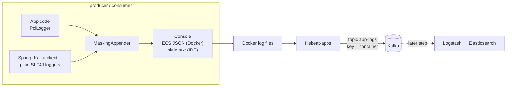
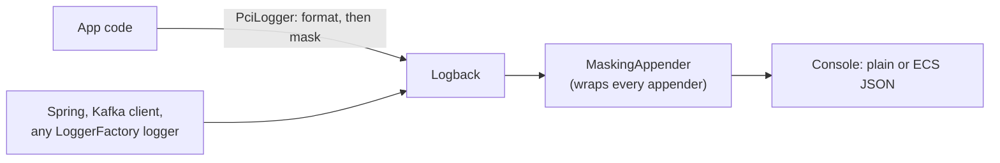

# Logging: ECS JSON, masking, and app logs in Kafka

*Step 04 of the ELK + Kafka + Grafana project · branch `step-04-logging`*

**Goal:** app logs in a form that can be shipped and searched, with no card or personal data in them.

Step 03 kept sensitive data out of Kafka messages, but the apps still logged it: the consumer decrypted records and wrote card numbers into its log. Step 04 fixes the logs and gets them ready for Elasticsearch:

1. **Masked:** a new `logging` package in `log-masking` masks card and personal data in every log line, in two independent places.
2. **Structured:** in Docker, both apps log **ECS JSON**, one object per line. From the IDE, they log plain text.
3. **Shipped:** a `filebeat-apps` container reads the apps' log lines and sends them to the Kafka topic **`app-logs`**, ready for Logstash in a later step.

This article covers:

1. [The big picture](#1-the-big-picture)
2. [Plain text vs. ECS JSON](#2-plain-text-vs-ecs-json)
3. [What each app logs](#3-what-each-app-logs)
4. [Log masking: the `logging` package](#4-log-masking-the-logging-package)
5. [From the apps to the `app-logs` topic](#5-from-the-apps-to-the-app-logs-topic)
6. [Corrections to earlier articles](#6-corrections-to-earlier-articles)
7. [What we checked](#7-what-we-checked)
8. [Limits](#8-limits)

---

## 1. The big picture



Two topics now carry "logs", and they are different things:

| Topic | Contains | Written by |
|-------|----------|------------|
| `app-logs` | The apps' **own log lines**: startup, requests, records consumed, errors. ECS JSON. | `filebeat-apps` |
| `app-log-messages` (new) | **Business log messages** sent through `POST /api/logs`: `LogMessage` records. | producer |

Before this step, `POST /api/logs` wrote to `app-logs`. It moved, so `app-logs` holds only one format, the one Logstash will read.

---

## 2. Plain text vs. ECS JSON

Spring Boot has **structured logging** built in. One property switches the console from human-readable lines to JSON:

```yaml
logging.structured.format.console: ecs     # env: LOGGING_STRUCTURED_FORMAT_CONSOLE=ecs
```

| | Plain text | ECS JSON |
|---|---|---|
| When | IDE, `mvn spring-boot:run` (the default) | Docker: Compose sets `LOGGING_STRUCTURED_FORMAT_CONSOLE: ecs` |
| Made for | People reading a terminal | Machines: Filebeat, Logstash, Elasticsearch |
| One line is | Text in a fixed pattern | One complete JSON object |
| Multi-line stack traces | Several lines | Inside one JSON field, so one event |
| Fields | Parsed back out with regexes (fragile) | Already separate: `log.level`, `service.name`, … |

The same masked event in both formats:

```text
2026-10-29T22:01:45.468+03:00  INFO 31640 --- [producer] [nio-8091-exec-2] i.g.o.producer.service.KafkaPublisher : Received for app-events: key=order-1001 value=AppEvent[... payload={card={number=************4444, holderName=***}, email=j***@example.com}]
```

```json
{"@timestamp":"2026-10-29T18:55:44.007Z",
 "log":{"level":"INFO","logger":"io.github.olgunyldz.producer.service.KafkaPublisher"},
 "process":{"pid":1,"thread":{"name":"http-nio-8081-exec-3"}},
 "service":{"name":"producer","version":"0.0.1-SNAPSHOT","environment":"docker"},
 "message":"Received for app-events: key=order-1001 value=AppEvent[... number=************4444, holderName=*** ...]",
 "ecs":{"version":"8.11"}}
```

**ECS** (Elastic Common Schema) is Elastic's standard set of field names. Elasticsearch and Kibana know them, so `log.level` and `service.name` work as filters without any mapping work. The fields come from:
- `service.name`: `spring.application.name` (`producer`, `consumer`)
- `service.version`: the project version from the jar
- `service.environment`: `LOGGING_STRUCTURED_ECS_SERVICE_ENVIRONMENT: docker` in Compose

Both settings sit in a shared `x-logging-env` block in [docker-compose.yml](../docker-compose.yml).

**Every line must be JSON.** Filebeat parses each line as JSON, and anything else becomes a parse error. The JVM used to print `Picked up JAVA_TOOL_OPTIONS: …` on stderr. The memory flag is now passed on the command line (`ENTRYPOINT ["java", "-XX:MaxRAMPercentage=75", …]`), and both containers write nothing but JSON.

---

## 3. What each app logs

All app code logs through `PciLogger`; libraries log through their own loggers. Both are masked (see [section 4](#4-log-masking-the-logging-package)).

**Producer** ([KafkaPublisher](../springboot/producer/src/main/java/io/github/olgunyldz/producer/service/KafkaPublisher.java)), two lines per message:

| Line | When | Shows |
|------|------|-------|
| `Received for <topic>: key=… value=…` | A request arrives | The message **as received**, masked by the logger |
| `Sent to <topic> partition <p> offset <o>: key=… value=… (removed n, encrypted m)` | Kafka acknowledged | The message **as stored in Kafka**: removed parts gone, encrypted parts as tokens (`pan:v1:4444:…`) |
| `Failed to send to <topic>: key=…` | Send failed | With the exception, masked |

**Consumer** ([listeners](../springboot/consumer/src/main/java/io/github/olgunyldz/consumer/listener)), one line per record:

```text
[group log-consumer] Key: support-service | Value: WARN support-service Refund request: Mastercard ****-****-****-4444 cvc=[REMOVED] expiry=**/** ... | Partition: 1 | Offset: 19
[group event-consumer] Key: customer-77 | Value: CustomerRegistered {customer={email=j***@example.com, nationalId=*********46, birthDate=***, lastName=***, address={city=***, street=***}, phone=+** *** *** ** 67, firstName=***}} | Partition: 1 | Offset: 435
```

The consumer receives records **decrypted** for its groups (step 03). The logger masks them again before they're written, so the log never holds the plain values.

**Both apps** also log what Spring Boot and the Kafka client log at `INFO`: startup, partition assignment, and so on. `org.apache.kafka` is set to `warn`, because the client is very chatty at `INFO`. At startup, each app logs one line confirming masking is on:

```text
Log masking enabled: PciLogger and 1 appender(s), rules: [secrets, personal, expiry, iban, card, tckn, email, phone]
```

---

## 4. Log masking: the `logging` package

Logs are **masked**, not encrypted like Kafka messages. Nobody reading a log needs the real card number, and nobody should need a key to read logs.

| Data | In a log line |
|------|---------------|
| Card number | `************1111`, `****-****-****-4444` (last 4, as PCI DSS 3.4 allows) |
| CVV, PIN, passwords, tokens, API keys | `cvc=***`, `Authorization: ***` |
| Card expiry | `expiry=**/**` |
| IBAN | `TR********************1326` |
| National ID | `*********46` |
| Email | `j***@example.com` |
| Phone | `+** *** *** ** 67`, `**** *** ** 67` |
| Names, birth date, address | `holderName=***`, `birthDate=***`, `street=***` |

### Two places, one set of rules



| | `PciLogger` | `MaskingAppender` |
|---|---|---|
| Covers | The app's own log lines | **Everything** that reaches Logback, including other libraries |
| How | An SLF4J `Logger` wrapper: formats the message with its arguments, masks it, then hands the finished text to the real logger | A Logback appender put in front of every configured appender; it hands the encoder a masked view of each event |
| Independent of | Spring and Logback: any SLF4J backend gets masked text | Which logger was used |

Both use the same `SensitiveDataMasker`, so an app line is masked even if the appender were removed, and a library line is masked even though it never touched `PciLogger`.

```java
private static final Logger log = PciLogger.getLogger(KafkaPublisher.class);   // instead of LoggerFactory
```

### The classes

| Class | Role |
|-------|------|
| [`SensitiveDataMasker`](../springboot/log-masking/src/main/java/io/github/olgunyldz/logmasking/logging/SensitiveDataMasker.java) | The rules. Uses the same patterns and checksums as the Kafka protection (`SensitiveDataDetector`, `CardNumbers`, `Checksums`), so logs and messages recognise exactly the same data. |
| [`PciLogger`](../springboot/log-masking/src/main/java/io/github/olgunyldz/logmasking/logging/PciLogger.java) | SLF4J logger that masks before the backend. Placeholders, markers and the fluent API (`log.atInfo().addKeyValue(…)`) work as usual. Caller data still points at the calling code, not the wrapper. |
| [`MaskingAppender`](../springboot/log-masking/src/main/java/io/github/olgunyldz/logmasking/logging/MaskingAppender.java) | Logback appender that passes a masked event to the appenders inside it. Also usable from a plain `logback.xml`. |
| [`MaskedLoggingEvent`](../springboot/log-masking/src/main/java/io/github/olgunyldz/logmasking/logging/MaskedLoggingEvent.java) | The masked view: message, MDC values, key-value pairs, exception messages. `getArgumentArray()` returns `null`, so an encoder can't rebuild the unmasked text from the arguments. |
| [`MaskedThrowableProxy`](../springboot/log-masking/src/main/java/io/github/olgunyldz/logmasking/logging/MaskedThrowableProxy.java) | An exception as Logback sees it, with masked messages for it, its causes and its suppressed exceptions. Stack frames stay. |
| [`MaskedThrowables`](../springboot/log-masking/src/main/java/io/github/olgunyldz/logmasking/logging/MaskedThrowables.java) | For `PciLogger`: an exception's message can't be changed, so a masked copy is logged, with the original type in its message and the same stack trace. Clean exceptions are logged as they are. |
| [`LogMasking`](../springboot/log-masking/src/main/java/io/github/olgunyldz/logmasking/logging/LogMasking.java) | Wraps every appender of a configured Logback context. Safe to call twice. |
| [`LogMaskingApplicationListener`](../springboot/log-masking/src/main/java/io/github/olgunyldz/logmasking/logging/spring/LogMaskingApplicationListener.java) | Turns it all on in Spring Boot, right after Spring Boot configures logging (plain or ECS). Registered in `META-INF/spring.factories`, so adding the jar is enough. |

### Rules

Applied in this order. Each can be turned off by name:

| Rule | Masks | Notes |
|------|-------|-------|
| `secrets` | Values after sensitive keys: `password`, `token`, `apiKey`, `authorization` (also `Bearer …`), `cvv`, `cvc2`, `pin`, … | `key=value`, `key: value`, `"key":"value"`; `_` in a key also matches `-` and nothing (`access_token`, `accessToken`) |
| `personal` | Values after personal keys: names, birth date, address fields | **Added in this project**, see below |
| `expiry` | `expiry=12/27`, `"expDate":"2027-12"` | |
| `iban` | IBANs that pass mod-97 | Country code and last 4 stay |
| `card` | Card numbers that pass Luhn, with a card network prefix | Last 4 stay |
| `tckn` | National IDs that pass the TCKN check | Last 2 stay |
| `email` | The local part, even if the domain was cut off | First character and domain stay |
| `phone` | International (`+90 …`) and Turkish mobile (`0532 …`) | Last 2 stay |

Because the number rules check checksums, order ids, timestamps and offsets stay readable. The tokens from step 03 (`pan:v1:4444:…`) also pass through untouched: they're already safe, and their hints stay useful.

**The `personal` rule** goes beyond the reference course's library. Names and addresses have no pattern, and the `secrets` rule stops a value at the first space, so `holderName=Jane Doe` would have leaked `Doe`, and `firstName=Jane` wasn't a secret at all. The `personal` rule masks the value of personal keys (`firstName`, `lastName`, `holderName`, `birthDate`, `street`, `city`, …) **up to the next delimiter**: quote, comma, semicolon, brace, bracket or line end. Spaces are included. Without a delimiter it masks to the end of the line, erring on the safe side.

### Configuration

```yaml
logging:
  masking:
    enabled: true                 # LOGGING_MASKING_ENABLED=false turns the appender off; PciLogger still masks
    disabled-rules: ""            # e.g. phone,email
    extra-sensitive-keys: ""      # e.g. otp,customer_ref          → masked by "secrets"
    extra-personal-keys: ""       # e.g. mother_maiden_name        → masked by "personal"
```

---

## 5. From the apps to the `app-logs` topic

The apps don't know about Kafka for their logs. They write to the console. Docker stores each container's console output in a JSON file, and `filebeat-apps` reads those files:

```yaml
# docker-compose.yml
filebeat-apps:
  image: elastic/filebeat:9.5.3
  user: root                    # to read the Docker socket and the container log files
  volumes:
    - ./filebeat/filebeat-apps.yml:/usr/share/filebeat/filebeat.yml:ro
    - /var/lib/docker/containers:/var/lib/docker/containers:ro
    - /var/run/docker.sock:/var/run/docker.sock:ro
    - filebeat-apps-data:/usr/share/filebeat/data    # how far each file was read
  networks: [service-layer]     # reaches the brokers
```

[filebeat/filebeat-apps.yml](../filebeat/filebeat-apps.yml):

1. **Finds** the `producer` and `consumer` containers through the Docker API (autodiscover). Other containers are ignored.
2. **Unwraps** two layers of JSON: Docker's wrapper (`container` parser), then the app's ECS object (`ndjson` parser). The ECS fields end up at the top level of the event.
3. **Adds** Docker metadata (`container.name`, image, …) and copies `container.name` to `service.compose`.
4. **Sends** each event to `app-logs` as one JSON document, with `acks=all` and gzip compression. The key is `container.name`, so each app's lines land in one partition and stay in order.

Why Filebeat instead of having the app send its logs to Kafka itself?
- The app stays simple. Writing to the console is the standard for containers.
- Logging never blocks or fails because Kafka is slow or down. Filebeat catches up from the files, and its registry (the `filebeat-apps-data` volume) remembers how far it got.
- Kafka acts as a buffer for whatever reads the logs next. If Logstash is down, logs wait in the topic.

Read the topic yourself:

```bash
docker exec kafka-1 /opt/kafka/bin/kafka-console-consumer.sh --bootstrap-server kafka-1:9092 \
  --topic app-logs --from-beginning --max-messages 3
```

Each record is the app's ECS event plus Filebeat's metadata: `@timestamp`, `message`, `log.level`, `log.logger`, `service.{name,version,environment,compose}`, `process`, `container`, `host`, `agent`, `ecs`.

---

## 6. Corrections to earlier articles

The [step 02](step-02-producer-consumer.md) and [step 03](step-03-protect-kafka-data.md) articles describe their own step and are left unchanged. On this branch, these statements in them are out of date:

| Earlier article says | Now |
|----------------------|-----|
| Step 03: "**Logs are not masked yet.** The apps still log with plain SLF4J `LoggerFactory` loggers… Step 06 adds log masking." | Logs are masked from this step on: `PciLogger` in the app code, plus `MaskingAppender` for everything else. |
| Step 03, *Who can read what*: our consumer's log shows plain text | The consumer still **receives** plain text, but its log lines are masked. |
| Step 03, *The library*: `log-masking` "contains only the `pci` package. Step 06 adds log masking" | It now also has the `logging` package (and `logging.spring`), plus `META-INF/spring.factories`. |
| Step 02 and 03: `POST /api/logs` publishes `LogMessage` records to `app-logs` | They go to the new topic `app-log-messages`; the web page's dropdown shows that name. `app-logs` holds the apps' own ECS log lines from Filebeat. |
| Step 01 and 02: `create-topics.sh` creates `app-logs`, `app-metrics`, `app-events` | It also creates `app-log-messages`. |
| Step 02 and 03: listeners log `[topic-partition@offset] …` | They log `[group <group>] Key: … \| Value: … \| Partition: … \| Offset: …`. |
| Step 02: the producer logs sends at `DEBUG` (`Sent to …`) | It logs `Received for …` and `Sent to … partition … offset …` at `INFO`. `io.github.olgunyldz.producer: DEBUG` was replaced by `org.apache.kafka: warn`. |
| Step 02, *Docker images*: `ENV JAVA_TOOL_OPTIONS="-XX:MaxRAMPercentage=75"` | The flag is in the `ENTRYPOINT`, so the JVM prints no plain-text line to stderr. |
| Step 02 and 03: Compose runs the cluster, `kafka-ui`, producer and consumer | It also runs `filebeat-apps`, with a new volume `filebeat-apps-data`. The apps get `LOGGING_STRUCTURED_FORMAT_CONSOLE: ecs`. |

---

## 7. What we checked

**Unit tests:** 151 in `log-masking`, all passing, including 51 for logging:
- `SensitiveDataMaskerTest`: every rule; what must stay readable (Luhn-invalid numbers, timestamps, Kafka offsets, `[REMOVED]`, `pci` tokens, metric names); turning rules off; extra keys.
- `MaskingAppenderTest`: message, arguments hidden, exception and cause, MDC, key-value pairs, installing twice.
- `PciLoggerTest`: arguments masked before the backend, a whole JSON value, the fluent API, exceptions, clean exceptions untouched, caller data, levels.

**Through the Docker stack**, after sending all ten samples:

| Check | Result |
|-------|--------|
| Lines in `docker compose logs producer consumer` that aren't JSON | 0 |
| Startup line | `Log masking enabled: PciLogger and 1 appender(s)` in both apps |
| Search the app logs **and** the `app-logs` topic for card numbers, CVC, expiry, IBAN, national ID, email, phone, password, JWT, first name, last name, street, city, birth date | Found in neither |
| `app-logs` records | ECS fields at the top level, plus container metadata; one record per log line |
| Plain-text mode (jar started without the ECS setting) | Masked the same way |

---

## 8. Limits

- **Pattern-based.** A name written in free text without a key (`"Call Jane Doe back"`) isn't masked. Keep personal data in `key=value` or JSON form when logging it.
- **The `personal` rule can mask too much.** Without a delimiter it masks to the end of the line. That's on purpose.
- **Records written before a fix stay as they are.** Kafka keeps `app-logs` for 7 days. During development of this step, a few test lines with unmasked names went into `app-logs` before the `personal` rule existed. To start clean, delete and recreate the topic (`kafka-topics.sh --delete --topic app-logs`, then `docker compose up -d --force-recreate kafka-init`).
- **Filebeat needs the Docker log files.** It mounts `/var/lib/docker/containers` and the Docker socket, and runs as root inside its container. That works on Linux and Docker Desktop, but not with every Docker setup.

---

## Next step

`app-logs` now holds masked, structured app logs, and `app-events`, `app-log-messages` and `app-metrics` hold protected messages. The next step adds **Logstash, Elasticsearch and Kibana** to read both and make them searchable.
