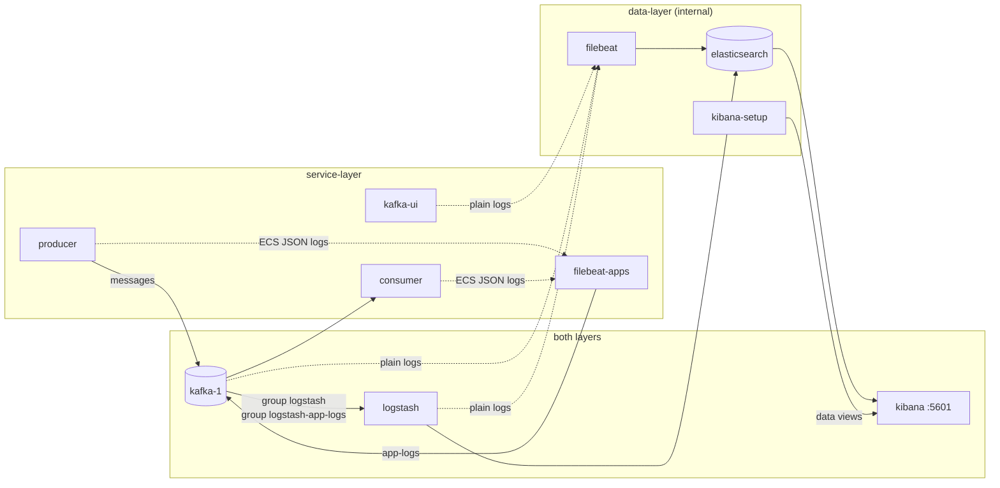

# ELK: Kafka messages and all logs searchable in Kibana

*Step 05 of the ELK + Kafka + Grafana project · branch `step-05-elk`*

**Goal:** Kafka messages and all logs searchable in Kibana.

Step 04 put masked, structured app logs into the `app-logs` topic. Step 05 adds the **ELK** stack, Elasticsearch, Logstash and Kibana, plus a second Filebeat, so that everything the lab produces ends up in one place:

| What | Path | Kibana data view |
|------|------|------------------|
| **Kafka messages** (`app-events`, `app-log-messages`, `app-metrics`) | Kafka → Logstash → `kafka-messages-<topic>` | *Kafka messages* |
| **App logs**: the microservices (producer, consumer) | console → `filebeat-apps` → Kafka `app-logs` → Logstash → `app-logs-YYYY.MM.dd` | *App logs* (the default) |
| **Infra logs**: the Kafka infrastructure (kafka-1, kafka-init, kafka-ui) | console → `filebeat` → Elasticsearch `infra-logs-YYYY.MM.dd` | *Infra logs* |
| **ELK logs**: Elasticsearch, Logstash, Kibana, kibana-setup | console → `filebeat` → Elasticsearch `elk-logs-YYYY.MM.dd` | — |
| Every log except the microservices': infra + ELK | | *All logs* |

To make room in memory, **Kafka is down to a single broker** in this step.

---

## 1. The big picture



| Service | Image | Role | Networks |
|---------|-------|------|----------|
| `elasticsearch` | `elasticsearch:9.5.3` | Stores and indexes everything | data-layer only (no published port) |
| `logstash` | `logstash:9.5.3` | Two Kafka consumers → Elasticsearch | both |
| `kibana` | `kibana:9.5.3` | Search UI, http://localhost:5601 | both (data-layer for Elasticsearch, service-layer for the port) |
| `kibana-setup` | `curlimages/curl:8.11.1` | Creates the data views, then exits | data-layer |
| `filebeat` | `elastic/filebeat:9.5.3` | Infra and ELK logs → Elasticsearch | data-layer |
| `filebeat-apps` | `elastic/filebeat:9.5.3` | App logs → Kafka (from step 04) | service-layer |

**Why two Filebeats, and why do app logs go through Kafka while the others don't?**
- **App logs → Kafka:** Kafka is a buffer. If Logstash or Elasticsearch is down or slow, app logs wait in `app-logs` and are indexed later. Nothing is lost, and the apps never wait for anything.
- **Infra logs → Elasticsearch directly:** the broker's logs explain *why* Kafka is unhealthy. If they depended on Kafka, they would be missing exactly when needed.

---

## 2. One broker instead of three

Elasticsearch, Logstash and Kibana are all JVM or Node.js processes, together about 3.5 GB. The three-broker cluster from step 01 would push the stack past what a laptop's Docker usually has, so it shrinks to one node:

| | Steps 01–04 | Step 05 |
|---|---|---|
| Brokers | `kafka-1`, `kafka-2`, `kafka-3` | `kafka-1` (broker and controller) |
| Host port | `localhost:19092`, `29092`, `39092` | `localhost:19092` |
| Bootstrap inside Docker | `kafka-1:9092,kafka-2:9092,kafka-3:9092` | `kafka-1:9092` |
| Replication factor | 3 | 1 |
| `min.insync.replicas` | 2 | 1 |
| Broker heap | Kafka default (1 GB) | `KAFKA_HEAP_OPTS: -Xms512m -Xmx512m` |
| Survives losing a broker | Yes | No: one broker, one copy |

Everything else stays the same: topics still have **3 partitions**, so consumer groups still spread over three threads, and keys still decide the partition. The producer keeps `acks=all`, which now means "the one broker has it".

**Upgrading an existing lab:** the old broker volumes hold a three-node cluster that a single node can't take over. Start fresh:

```bash
docker compose down -v --remove-orphans
docker volume rm elk-kafka-grafana_kafka-2-data elk-kafka-grafana_kafka-3-data
docker compose up -d --build
```

### Memory

Measured with everything running, after sending all samples:

| Container | Memory |
|-----------|--------|
| elasticsearch (heap 768 MB) | 1.6 GB |
| kibana (Node heap 768 MB) | 1.0 GB |
| logstash (heap 512 MB) | 0.8 GB |
| kafka-1 (heap 512 MB) | 0.4 GB |
| consumer, producer | 0.3–0.4 GB each |
| kafka-ui | 0.3 GB |
| filebeat, filebeat-apps | < 0.1 GB each |
| **Total** | **about 5 GB** |

Give Docker at least 6 GB (Docker Desktop → Settings → Resources).

---

## 3. Elasticsearch

```yaml
elasticsearch:
  environment:
    discovery.type: single-node                 # no cluster forming
    xpack.security.enabled: "false"             # no passwords or TLS, like the rest of the lab
    ES_JAVA_OPTS: -Xms768m -Xmx768m
    node.store.allow_mmap: "false"              # no vm.max_map_count=262144 needed on Docker Desktop
    cluster.routing.allocation.disk.threshold_enabled: "false"   # don't go read-only on a full laptop disk
  networks: [data-layer]
```

Elasticsearch is a **store**, so it lives only on the internal `data-layer`. It has no published port and no route out. To query it from your machine, go through the container:

```bash
docker exec elasticsearch curl -s 'localhost:9200/_cat/indices?v&s=index'
docker exec elasticsearch curl -s 'localhost:9200/app-logs-*/_search?q=log.level:ERROR&size=3'
```

Or use **Kibana → Dev Tools**.

> Security is off because this is a local lab. A real deployment needs `xpack.security.enabled: true`, passwords, TLS, and probably a published port behind a firewall.

---

## 4. Logstash: two pipelines, two consumer groups

[logstash/pipelines.yml](../logstash/pipelines.yml) runs two **independent** pipelines. Without it, Logstash merges every `.conf` file into one pipeline, and every event goes through every output.

### `kafka-messages`: the business messages

[logstash/pipeline/kafka-messages.conf](../logstash/pipeline/kafka-messages.conf)

| Step | What happens |
|------|--------------|
| Input | Consumer group **`logstash`** reads `app-events`, `app-log-messages`, `app-metrics` from the beginning, 3 threads (one per partition) |
| `decorate_events => extended` | Topic, partition, offset, key, timestamp **and headers** become `[@metadata][kafka]` |
| Fields added | `kafka.topic`, `kafka.partition`, `kafka.offset`, `kafka.key`, `kafka.consumer_group`, `kafka.type` (the `__TypeId__` header: `log`, `event`, `metric`), `kafka.pci_protected` (whether the `pci-protected` header is set) |
| `@timestamp` | The **Kafka record timestamp**, when the producer sent it, not when Logstash read it |
| `json` filter | The record's JSON becomes searchable fields under `payload.*`; the raw text stays in `message` |
| Output | Index `kafka-messages-<topic>` |

Logstash is just another consumer group, and it's **not** in the consumer app's `pci.decrypt.consumer-groups`. It doesn't have the key anyway. So Elasticsearch stores exactly what Kafka holds:

```json
"kafka":   { "topic": "app-events", "key": "order-1001", "type": "event", "pci_protected": true, ... },
"payload": { "type": "PaymentAuthorized", "aggregateId": "order-1001",
             "payload": { "amount": 129.9, "currency": "EUR",
                          "card": { "number": "pan:v1:4444:5MN8uNf6…",
                                    "expiry": "exp:v1::_g0DPZCK…",
                                    "holderName": "pii:v1::bh5I162_…" } } }
```

The hints from step 03 are useful here. `payload.payload.card.number : pan\:v1\:4444*` finds every payment with a card ending in 4444, and `kafka.pci_protected : true` lists every message that had something encrypted, all without the key.

### `app-logs`: the apps' log lines

[logstash/pipeline/app-logs.conf](../logstash/pipeline/app-logs.conf)

| Step | What happens |
|------|--------------|
| Input | Consumer group **`logstash-app-logs`** reads `app-logs`, `codec => json` (Filebeat's event, already parsed) |
| Fields added | `kafka.topic`, `kafka.partition`, `kafka.offset` |
| Removed | `event.original`, the raw JSON, which would double every document's size |
| Output | Daily index `app-logs-YYYY.MM.dd` |

The documents keep the ECS fields from step 04: `log.level`, `log.logger`, `service.name`, `service.environment`, `message`, `process.thread.name`, plus Filebeat's `container.*` and `service.compose`. The messages arrive already masked by the apps.

### Lag

Both pipelines are ordinary consumer groups, so lag works as in step 01:

```bash
docker exec kafka-1 /opt/kafka/bin/kafka-consumer-groups.sh --bootstrap-server kafka-1:9092 \
  --describe --group logstash
docker exec kafka-1 /opt/kafka/bin/kafka-consumer-groups.sh --bootstrap-server kafka-1:9092 \
  --describe --group logstash-app-logs
```

Stop Logstash (`docker compose stop logstash`), send messages, and watch `LAG` grow. Start it again and it catches up: nothing is lost, which is the point of having Kafka in front.

---

## 5. Filebeat for everything but the microservices

[filebeat/filebeat.yml](../filebeat/filebeat.yml) reads the Docker log files of every container in this Compose project, **except**:
- `producer` and `consumer`: the microservices; `filebeat-apps` handles them, through Kafka,
- `filebeat` and `filebeat-apps` themselves.

It writes straight to Elasticsearch, into two kinds of daily index:

| Index | Containers |
|-------|------------|
| `infra-logs-YYYY.MM.dd` | The Kafka infrastructure: `kafka-1`, `kafka-init`, `kafka-ui` |
| `elk-logs-YYYY.MM.dd` | The ELK stack: `elasticsearch`, `logstash`, `kibana`, `kibana-setup` |

The routing is a condition on `container.name` in `output.elasticsearch.indices`. Anything not listed for `infra-logs` lands in `elk-logs`. The indices replace Filebeat's default `filebeat-<version>` data stream, so they sit next to `app-logs-*` with matching names. They have no Filebeat template or ILM policy: Elasticsearch maps the fields dynamically, which is plenty for a lab.

The broker and `kafka-init` get a **multiline** rule: a Kafka log line starts with `[2026-10-30 …]`, and every following line that doesn't, such as a stack trace, is joined to it, so one exception is one event.

---

## 6. Kibana

http://localhost:5601. [scripts/kibana-setup.sh](../scripts/kibana-setup.sh) runs once in the `kibana-setup` container. It waits for Kibana, then creates the data views through the Kibana API. Running it again simply overwrites them.

| Data view | Pattern | Shows |
|-----------|---------|-------|
| **App logs** (default) | `app-logs-*` | The microservices: producer and consumer |
| **Infra logs** | `infra-logs-*` | The Kafka infrastructure: kafka-1, kafka-init, kafka-ui |
| **All logs** | `infra-logs-*,elk-logs-*` | Every log **except the microservices'**: the Kafka infrastructure plus the ELK stack (Elasticsearch, Logstash, Kibana, kibana-setup) |
| **Kafka messages** | `kafka-messages-*` | Every record of the three message topics |

The microservices' logs have one place, *App logs*, so they never mix with the infrastructure's much louder output.

Kibana runs with usage collection turned off, and without the "your data is not secure" banner; security is off on purpose here.

### Things to search (Discover, KQL)

| Data view | Query | Finds |
|-----------|-------|-------|
| App logs | `log.level : ERROR` | Errors from the microservices |
| App logs | `service.name : consumer and message : "group event-consumer"` | Every event the consumer handled |
| App logs | `message : "Sent to" and message : "removed"` | Producer sends, with how much was removed or encrypted |
| Kafka messages | `kafka.pci_protected : true` | Messages where something was encrypted |
| Kafka messages | `kafka.topic : "app-events" and payload.type : "PaymentAuthorized"` | Payments |
| Kafka messages | `payload.payload.card.number : pan\:v1\:4444*` | Payments with a card ending in 4444, without decrypting |
| Infra logs | `container.name : "kafka-1" and message : "ERROR"` | Broker errors |
| All logs | `container.name : "logstash" and message : "ERROR"` | Logstash errors, e.g. a broken pipeline |

---

## 7. Corrections to earlier articles

The step 01–04 articles describe their own step and are left unchanged. On this branch, these statements are out of date:

| Earlier article says | Now |
|----------------------|-----|
| Step 01: a **three-node** cluster, `kafka-1..3`, host ports `19092`, `29092`, `39092` | One node, `kafka-1`, host port `19092`. |
| Step 01: replication factor 3, `min.insync.replicas` 2, "one broker can go down without losing data or blocking writes"; the failover exercise | Replication factor 1, `min.insync.replicas` 1. No failover: if `kafka-1` stops, Kafka is down. The failover exercise needs the three-broker setup of steps 01–04. |
| Step 01: `create-topics.sh` creates topics `name:3:3` | `name:3:1`: still 3 partitions, one replica each. |
| Step 01–04: bootstrap servers `kafka-1:9092,kafka-2:9092,kafka-3:9092` (apps, kafka-ui, kafka-init, Filebeat) | `kafka-1:9092`. The apps' default for running outside Docker is `localhost:19092`. |
| Step 02, delivery guarantees: with `acks=all`, "an acknowledged record exists on at least two brokers" | With one broker it exists once. The setting stays, so it's right again on a real cluster. |
| Step 02 and 04, network layers: `data-layer` holds the brokers and `kafka-init` | It also holds `elasticsearch`, `filebeat` and `kibana-setup`; `logstash` and `kibana` join both layers. |
| Step 04: "The next step adds Logstash, Elasticsearch and Kibana"; `app-logs` waits for "Logstash in a later step" | They're here. `app-logs` is read by the Logstash group `logstash-app-logs`. |
| Step 01 docs / README: the broker uses Kafka's default heap | `KAFKA_HEAP_OPTS: -Xms512m -Xmx512m`. |

---

## 8. What we checked

Starting fresh (`down -v`), with all ten samples sent:

| Check | Result |
|-------|--------|
| All containers | Healthy, or finished with exit 0 (`kafka-init`, `kibana-setup`) |
| Topics | 4 topics, 3 partitions, replication factor 1 |
| Data views | 4 created: *App logs* (default), *Infra logs*, *All logs*, *Kafka messages* |
| Indices | `app-logs-2026.10.30` (64 log lines), `kafka-messages-app-events` / `-app-log-messages` / `-app-metrics`, `infra-logs-*` (kafka-1, kafka-ui), `elk-logs-*` (logstash, elasticsearch, kibana, kibana-setup) |
| Logstash lag | 0 for both groups |
| Logstash errors | None |
| Search **all** of `app-logs-*`, `kafka-messages-*`, `infra-logs-*` and `elk-logs-*` for the samples' card numbers, CVC, expiry, IBAN, national ID, emails, phones, password, API key, JWT, names, street and birth date | Found nowhere |
| Kibana Discover | *App logs* and *Kafka messages* load; `kafka.pci_protected : true` returns the 5 protected messages with their tokens |
| Memory | About 5 GB in total |

---

## 9. Limits

- **No failover.** One broker, one copy of every record.
- **No security.** Elasticsearch and Kibana have no login and no TLS. That's fine on a laptop, not anywhere else.
- **No masking in Filebeat or Logstash.** The apps mask their logs and the producer encrypts its messages, so nothing sensitive arrives today. A service that doesn't use the `log-masking` library, though, would be indexed as it is. A later step can add masking in Logstash as a safety net.
- **Containers that finished before Filebeat started.** `kafka-init` exits before Elasticsearch is healthy, so its few lines usually don't reach the *Infra logs*. Use `docker compose logs kafka-init` for those.
- **Index growth.** There's no retention policy yet: `app-logs-*` gets a new index every day, and `kafka-messages-*` grows forever. Delete old indices by hand, or add an ILM policy later.

---

## Next step

Everything is searchable now. The next step adds **Grafana**, with metrics such as consumer lag and request rates, alongside the logs.
