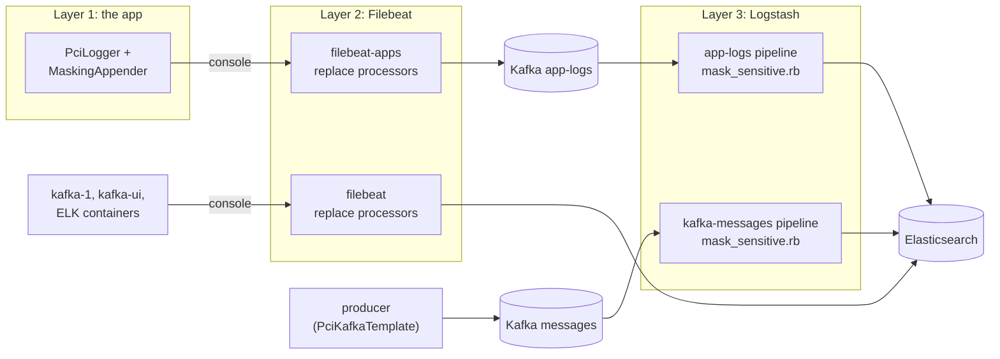

# Masking in three layers: no sensitive data in any log

*Step 06 of the ELK + Kafka + Grafana project · branch `step-06-mask-logging`*

**Goal:** no sensitive data in any log, at three layers.

Step 04 masked logs **in the apps**: `PciLogger` and `MaskingAppender` from the `log-masking` library. That covers our two services, but only them. A new service that logs with plain `LoggerFactory` and skips the library, a library that dumps a request body, or a producer that writes to Kafka without `PciKafkaTemplate` would all send card and personal data straight into Elasticsearch.

Step 06 adds two more gates on the way to Elasticsearch, so that no single mistake leaks data:

| Layer | Where | Covers | Precision |
|-------|-------|--------|-----------|
| **1. App** (step 04) | `log-masking`: `PciLogger`, `MaskingAppender` | Logs of apps that use the library | Checksums, every rule |
| **2. Filebeat** (new) | `replace` processors in both Filebeat configs | **Every** container log Filebeat ships: app logs (to Kafka) and infra and ELK logs (to Elasticsearch) | Go regexps: no lookbehind, no checksums; masks a little too much rather than too little |
| **3. Logstash** (new) | `mask_sensitive.rb`, called by both pipelines | **Everything** Logstash stores: app logs **and Kafka messages** | Checksums, key-aware, with self-tests |

---

## 1. Where each layer sits



| Data | Layers it passes |
|------|------------------|
| Microservice logs (`app-logs-*`) | 1 → 2 → 3 |
| Infra and ELK logs (`infra-logs-*`, `elk-logs-*`) | 2 (they don't go through Logstash) |
| Kafka messages (`kafka-messages-*`) | Producer protection from step 03 → 3 |

---

## 2. What is masked

All three layers mask the same kinds of data the same way, so a value looks the same whichever layer caught it:

| Data | Masked as |
|------|-----------|
| Card number | `************1111` (last 4) |
| CVV, PIN, password, secret, API key, token, `Authorization: Bearer …` | `cvv=***`, `Authorization: ***` |
| Card expiry | `expiry=**/**` |
| IBAN | `TR********************1326` |
| National ID (TCKN) | `*********46` |
| Email | `j***@example.com` |
| Phone | `+** *** *** ** 67`, `**** *** ** 67` |
| Names, birth date, address | `holderName=***`, `birthDate=***`, `city=***` |

Tokens from step 03 (`pan:v1:4444:…`) and values already removed (`[REMOVED]`) are **left alone** by layers 1 and 3: they're already safe, and their hints stay searchable. Layer 2 can't skip tokens, see [section 3](#3-layer-2-filebeat).

---

## 3. Layer 2: Filebeat

Both [filebeat/filebeat.yml](../filebeat/filebeat.yml) and [filebeat/filebeat-apps.yml](../filebeat/filebeat-apps.yml) get the same `replace` processor on the `message` field. The two copies must be kept in sync.

```yaml
- replace:
    ignore_missing: true
    fail_on_error: false
    fields:
      - field: message
        pattern: '(?i)(["'']?\b(?:password|…|cvv2?|cvc2?|…|pin|…)\b["'']?\s*[:=]\s*["'']?)(?:(?:Bearer|Basic)\s+)?[^"''\s,;&}\[\]]*[^"''\s,;&}\[\].]'
        replacement: '$1***'
      # … personal keys, expiry, IBAN, card, national ID, email, international phone, Turkish mobile
```

| Rule | Pattern idea |
|------|--------------|
| Secrets | Value after `password`, `token`, `cvv`, `pin`, `authorization`, `tckn`, … |
| Personal | Value after `firstName`, `holderName`, `birthDate`, `street`, `city`, …, spaces included, up to the next delimiter |
| Expiry | `expiry=12/27` |
| IBAN | Two letters, two digits, groups of four |
| Card | 13–19 digits starting with 2–6 |
| National ID | 11 digits, first not 0 |
| Email | The local part, even if the domain is cut off |
| Phone | `+` and 8–15 digits; Turkish mobile `05xx xxx xx xx` |

**Why it's stricter than the other layers:** Filebeat uses Go's RE2 regular expressions, which have no lookbehind and can't call a checksum function. A 16-digit number starting with 4 is masked whether or not it passes Luhn, and any 11-digit number is masked like a national ID. That's the right trade-off for a safety net: an occasional harmless number masked, never a real card number missed. For exactly the same reason, it also masks tokens that follow a personal key (`holderName=pii:v1::…` becomes `holderName=***` in app logs). That's harmless, since the tokens are already safe.

Replacements use `$1`, not `${1}`: Filebeat would read `${…}` as an environment variable.

---

## 4. Layer 3: Logstash

[logstash/pipeline/shared/mask_sensitive.rb](../logstash/pipeline/shared/mask_sensitive.rb) is a Ruby script that both pipelines call as their last filter:

```ruby
# logstash/pipeline/app-logs.conf
ruby {
  path          => "/usr/share/logstash/pipeline/shared/mask_sensitive.rb"
  script_params => { "fields" => ["message", "[error][message]", "[error][stack_trace]"] }
}

# logstash/pipeline/kafka-messages.conf
ruby {
  path          => "/usr/share/logstash/pipeline/shared/mask_sensitive.rb"
  script_params => { "fields" => ["message", "[payload]"] }
}
```

It works like the Java `SensitiveDataMasker`:
- **Checksums:** card numbers must pass Luhn and start with a card network prefix (2–6, or Troy's 9792). IBANs must pass mod-97, and national IDs must pass the TCKN check. Order ids, timestamps and offsets stay readable.
- **Walks structures:** strings, hashes and arrays. The whole parsed `payload` of a Kafka message is masked field by field.
- **Key-aware in hashes:** a value under a sensitive or personal key is masked whole, even when it has no pattern. `{"cvv": 737}` becomes `{"cvv": "***"}`, `{"holderName": "Jane Doe"}` becomes `{"holderName": "***"}`, and everything under `address` is masked.
- **Leaves tokens alone:** text is split around `pan:v1:…`-style tokens, and only the parts between them are masked. A token's random payload can contain digit runs that look like a card number or phone, and masking those would corrupt the token. Values that are a token or `[REMOVED]` stay as they are.

The `kafka-messages` pipeline is the **only** layer for messages that bypass `PciKafkaTemplate`. Nothing else stands between such a producer and Elasticsearch.

### Self-tests at pipeline start

The script ends with `test` blocks. Logstash runs them every time a pipeline starts, and **if one fails, the pipeline doesn't start**, so a broken rule can't silently let data through.

| Test | Checks |
|------|--------|
| Card number | Last 4 stay |
| Secrets, IBAN, TCKN, email, phone | Each one masked in one line |
| Personal keys | `holderName=Jane Doe` → `holderName=***`, spaces included |
| Nested payload | By value (card in a field) and by key (`cvv`, `holderName`, `address.city`) |
| Tokens and removed values | `pan:v1:…` and `[REMOVED]` stay exactly as they are |
| Normal log lines | Keys, partitions, offsets, timestamps and a Luhn-invalid number are unchanged |

```bash
docker compose logs logstash | grep "Test run complete"
# … results: {passed: 6, failed: 0, errored: 0}   (once per pipeline)
```

---

## 5. Try it

Each check below skips the earlier layers on purpose, to show that every layer works on its own.

**Layer 2 alone** (the infra path has no Logstash): write an unmasked line straight into the broker's console, as a service without our library would:

```bash
docker exec kafka-1 sh -c "echo '[2026-10-30 05:30:00,000] INFO LEAKTEST card 4111 1111 1111 1111 cvv=123 password=hunter2 holderName=Jane Doe, mail jane.doe@example.com tckn 10000000146' > /proc/1/fd/1"
```

In Kibana, *Infra logs*, `message : LEAKTEST`:

```text
[2026-10-30 05:30:00,000] INFO LEAKTEST card ************1111 cvv=*** password=*** holderName=***, mail j***@example.com tckn *********46
```

**Layer 3 alone:** produce an unprotected message straight into Kafka, without `PciKafkaTemplate`:

```bash
echo 'leak-1|{"type":"LeakTest","aggregateId":"leak-1","payload":{"pan":"5555555555554444","cvv":"737","holderName":"Jane Doe","email":"jane.doe@example.com","address":{"city":"Istanbul"}}}' \
  | docker exec -i kafka-1 /opt/kafka/bin/kafka-console-producer.sh --bootstrap-server kafka-1:9092 \
      --topic app-events --property parse.key=true --property key.separator='|'
```

In Kibana, *Kafka messages*, `kafka.key : leak-1`:

```json
"payload": { "pan": "************4444", "cvv": "***", "holderName": "***",
             "email": "j***@example.com", "address": { "city": "***" } }
```

`kafka.pci_protected` is `false`: Elasticsearch shows that this message bypassed the producer's protection.

> On Git Bash for Windows, put `MSYS_NO_PATHCONV=1` before `docker exec`.

---

## 6. Corrections to earlier articles

The earlier articles describe their own step and are left unchanged. On this branch, these statements are out of date:

| Earlier article says | Now |
|----------------------|-----|
| Step 04, *Next step* / limits: Filebeat and Logstash do no masking ("The reference also masks inside Filebeat and Logstash… I didn't add that here") | Both do: layers 2 and 3. |
| Step 04: the apps' masking is the only protection for logs | It's layer 1 of 3. |
| Step 05, limits: "No masking in Filebeat or Logstash… A service that doesn't use the `log-masking` library would be indexed as it is" | Its logs are masked by Filebeat, and also by Logstash if it's a microservice. Its Kafka messages are masked by Logstash. |
| Step 05, Logstash pipelines: input → fields → timestamp → JSON → output | Both pipelines end with the `mask_sensitive.rb` filter. |
| Step 05: `kafka-messages-*` stores exactly what Kafka holds | Unless a message carries unprotected data; then Elasticsearch holds a masked copy. Kafka itself still has the original until retention removes it. |
| Step 05, Filebeat: processors are `copy_fields` only | Plus the masking `replace` processor, in both Filebeat configs. |

---

## 7. What we checked

| Check | Result |
|-------|--------|
| Logstash self-tests | 6 passed, 0 failed, in both pipelines; both pipelines running |
| Filebeat | No errors after the new processors |
| **Layer 2 alone**, infra path (a raw line in `kafka-1`'s console) | Card, CVV, password, expiry, name, email, IBAN, national ID, mobile, Bearer token: all masked in `infra-logs-*` |
| **Layer 2 alone**, app path (a raw ECS line in the producer's console, read from `app-logs` **before** Logstash) | All masked by Filebeat, except the bare national ID (`tckn 10000000146`). Hence the 11-digit rule added in this step; on this path, Logstash catches it anyway |
| **Layer 3 alone** (an unprotected message produced straight into `app-events`; a raw line produced straight into `app-logs`) | Everything masked, including `cvv` and `holderName` by key, and `address.city` under a personal object |
| Normal traffic: all samples sent, then every token in Kafka compared with Elasticsearch | 44 of 44 tokens identical: the new layers don't corrupt tokens |
| Logstash indexing errors during normal traffic | 0 |

---

## 8. Limits

- **Layer 2 masks too much at times.** Any 11-digit number looks like a national ID, any card-like 13–19 digit number is masked, and the `address` key catches harmless values such as a host address in an infra log line. That's the price of no checksums.
- **Layer 2 only looks at `message`.** Other fields of an infra log line, such as an ECS `error.message` from a non-library service, pass Filebeat unmasked. On the app path, Logstash masks `error.message` and `error.stack_trace`; on the infra path nothing does.
- **Kafka keeps the original.** Layer 3 masks what goes into Elasticsearch, not what's in Kafka. An unprotected message stays readable in its topic until retention (7 days) removes it. Only `PciKafkaTemplate` protects the topic itself.
- **Free-text names without a key** (`"Call Jane Doe back"`) aren't caught by any layer.
- **Mapping conflicts.** Indices use dynamic mapping. If one message has `payload.card` as an object and another as a string, Elasticsearch rejects the second one (`document_parsing_exception`), and Logstash logs `Could not index event`. Keep message shapes stable per topic.
- **Two copies to keep in sync:** the Filebeat rules exist in both Filebeat configs, and the Ruby script mirrors the Java masker. Change all three together.

---

## Next step

Logs and messages are searchable and safe at every hop. The next step adds **metrics and Grafana**: consumer lag, request rates and JVM health next to the logs.
