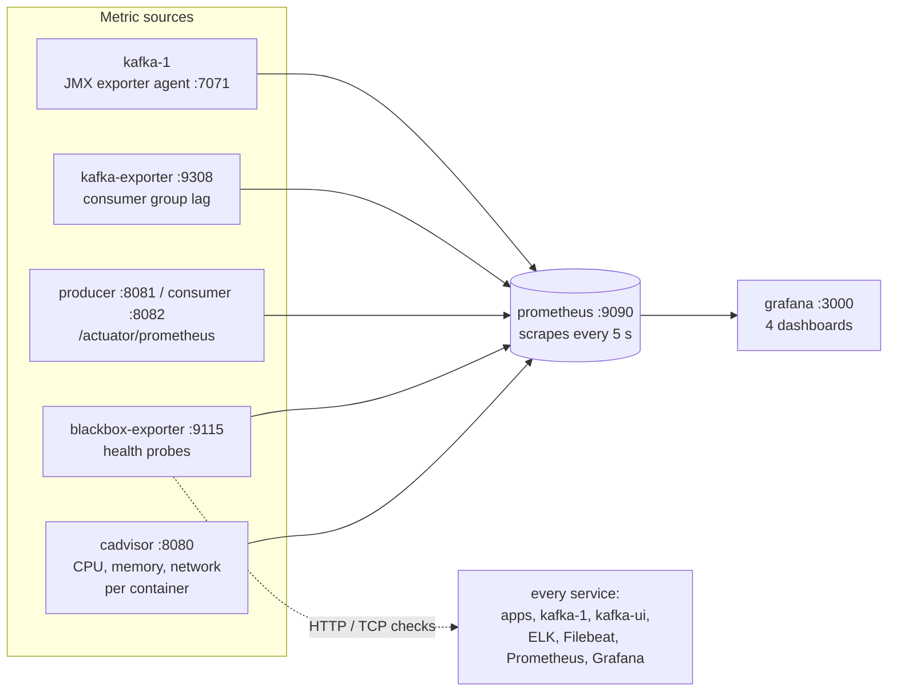

# Monitoring: Prometheus and Grafana

*Step 07 of the ELK + Kafka + Grafana project · branch `step-07-monitoring`*

**Goal:** metrics and health of the broker, the apps and every container, in Grafana, including CPU and memory per container.

Kibana (steps 05–06) answers *what happened*: log lines and messages. Monitoring answers *how things are doing right now and over time*: Is the consumer keeping up? How fast is the producer sending? Is every service up? Is the broker's heap filling? Those are numbers over time, which is what **Prometheus** stores and **Grafana** draws.

Open **Grafana at http://localhost:3000**, with no login. It starts on the *Kafka* dashboard.

---

## 1. The big picture



| Service | Image | Role | Networks |
|---------|-------|------|----------|
| `jmx-exporter-download` | `curlimages/curl:8.11.1` | Downloads the JMX exporter agent jar once into the `jmx-agent` volume, then exits | service-layer (needs the internet) |
| `kafka-1` | `apache/kafka:4.0.0` | Now loads the agent and serves broker metrics on `:7071` | both |
| `kafka-exporter` | `danielqsj/kafka-exporter:v1.8.0` | Consumer group offsets and lag, read from the broker | service-layer |
| `blackbox-exporter` | `prom/blackbox-exporter:v0.25.0` | Checks each service's health URL or port | both |
| `cadvisor` | `ghcr.io/google/cadvisor:0.55.1` | CPU, memory and network per container | service-layer |
| `prometheus` | `prom/prometheus:v2.55.1` | Scrapes everything every 5 s; UI at http://localhost:9090 | both |
| `grafana` | `grafana/grafana:11.3.1` | Dashboards at http://localhost:3000 | service-layer |

Prometheus and blackbox-exporter join both network layers, because Elasticsearch and `filebeat` live only on the internal `data-layer`.

---

## 2. Where the metrics come from

### The broker: JMX exporter agent

Kafka publishes its internal metrics as JMX MBeans. The Prometheus JMX exporter runs **inside** the broker's JVM as a Java agent and serves them over HTTP:

```yaml
kafka-1:
  command:
    - bash
    - -c
    - >-
      export KAFKA_OPTS="-javaagent:/opt/jmx-exporter/jmx_prometheus_javaagent.jar=7071:/opt/jmx-exporter-config/kafka-jmx.yml"
      && exec /etc/kafka/docker/run
  volumes:
    - jmx-agent:/opt/jmx-exporter:ro
    - ./monitoring/kafka-jmx.yml:/opt/jmx-exporter-config/kafka-jmx.yml:ro
```

`KAFKA_OPTS` is set **only for the broker process**, not as a container environment variable. Every `kafka-*.sh` tool you run with `docker exec`, and the health check itself, starts a JVM. With `KAFKA_OPTS` in the environment, each of those would load the agent too and fail, because port 7071 is already taken by the broker.

[monitoring/kafka-jmx.yml](../monitoring/kafka-jmx.yml) picks which MBeans become metrics:

| MBean | Metric | Shows |
|-------|--------|-------|
| `BrokerTopicMetrics` | `kafka_server_brokertopicmetrics_messagesinpersec_total{topic}`, `…bytesin…`, `…bytesout…` | Traffic per topic and in total |
| `ReplicaManager` | `kafka_server_replicamanager_underreplicatedpartitions`, `…leadercount` | Replica health |
| `KafkaController` | `kafka_controller_kafkacontroller_activecontrollercount`, `…offlinepartitionscount`, `…globaltopiccount` | KRaft controller state |
| `RequestMetrics` | `kafka_network_requestmetrics_totaltimems{request, stat}`, `…requests_total` | Request time and count for Produce and Fetch |

### Consumer lag: kafka-exporter

`kafka-exporter` asks the broker for every consumer group's committed offsets and every partition's latest offset. The difference is the **lag**:

```text
kafka_consumergroup_lag{consumergroup="event-consumer", topic="app-events", partition="1"}  0
kafka_consumergroup_lag_sum{consumergroup="logstash-app-logs", topic="app-logs"}            0
```

It sees all five groups: our consumer's three (`log-consumer`, `event-consumer`, `metric-consumer`) and Logstash's two (`logstash`, `logstash-app-logs`). Lag measured **from the broker** is the honest number: it keeps rising even when a consumer is dead and can't report anything itself.

### The apps: Spring Boot Actuator + Micrometer

Both apps gained `micrometer-registry-prometheus` and expose `/actuator/prometheus`:

```yaml
management:
  endpoints.web.exposure.include: health,info,prometheus
  metrics.tags.application: ${spring.application.name}    # application="producer" / "consumer" on every metric
```

That brings, without any code:

| Prefix | From | Examples |
|--------|------|----------|
| `kafka_producer_*`, `kafka_consumer_*` | The Kafka client, via Micrometer | `record_send_total`, `request_latency_avg`, `records_lag_max`, `time_between_poll_max`, `assigned_partitions` |
| `spring_kafka_template_seconds` | `KafkaTemplate` (used inside `PciKafkaTemplate`) | Time from `send()` to acknowledgement, by `result` and `exception` |
| `spring_kafka_listener_seconds` | Each `@KafkaListener` | Processing time per record, by listener `name` and `result` |
| `http_server_requests_seconds` | Spring MVC | The producer's `/api/*` endpoints, by `uri` and `status` |
| `jvm_*`, `process_*` | The JVM | Heap, GC, threads, CPU |

The listeners now have ids (`@KafkaListener(id = "log-listener", …)`), so their metrics read `log-listener-0..2` instead of `org.springframework.kafka.KafkaListenerEndpointContainer#1-0`. Each listener's explicit `groupId` takes precedence over the id for the consumer group, so the groups are unchanged.

### Health: blackbox-exporter

Prometheus asks blackbox-exporter to probe each service, and records `probe_success` (1 or 0) with a `service` label:

| Module | Checks | Targets |
|--------|--------|---------|
| `http_2xx` | The URL answers with 2xx | producer, consumer (`/actuator/health`), kafka-ui, kafka-exporter, Prometheus, Grafana, Elasticsearch, Kibana, Logstash (`:9600`), filebeat, filebeat-apps (`:5066`) |
| `tcp_connect` | The port accepts connections | kafka-1:9092 |

Spring Boot's health endpoint answers **503** when the app is DOWN, for example when it can't reach Kafka, so the probe fails exactly when it should.

### Every container: cAdvisor

cAdvisor reads each container's resource usage from the kernel's cgroups, and the container names and labels from the Docker API:

| Metric | Shows |
|--------|-------|
| `container_cpu_usage_seconds_total` | CPU time used; `rate(…[1m])` = cores in use |
| `container_memory_working_set_bytes` | Memory the container uses and can't give back: what counts against a memory limit, and what the OOM killer looks at |
| `container_memory_rss`, `container_memory_cache` | Process memory vs. file cache the kernel can drop |
| `container_network_receive_bytes_total`, `…transmit…` | Network traffic |
| `container_start_time_seconds` | When the container started |
| `machine_cpu_cores`, `machine_memory_bytes` | What Docker has in total |

```yaml
cadvisor:
  image: ghcr.io/google/cadvisor:0.55.1
  privileged: true                # reads the host's cgroups
  command:
    - --docker_only=true          # containers only, not every process on the machine
    - --housekeeping_interval=10s
    - --disable_metrics=…,disk,diskIO,…
    - --whitelisted_container_labels=com.docker.compose.project,com.docker.compose.service
  volumes: [/:/rootfs:ro, /var/run:/var/run:ro, /var/run/docker.sock:/var/run/docker.sock:ro,
            /sys:/sys:ro, /var/lib/docker/:/var/lib/docker:ro, /dev/disk/:/dev/disk:ro]
```

Three things it took to make it work on Docker Desktop:

| Problem | Fix |
|---------|-----|
| cAdvisor saw only the whole machine (`id="/"`): it couldn't reach the Docker API | Mount `/var/run/docker.sock` explicitly. On Docker Desktop, mounting `/var/run` doesn't bring the socket along. |
| *"failed to identify the read-write layer ID"* for every container | Docker Desktop stores images with the **containerd snapshotter**. cAdvisor before 0.54 (including `gcr.io/cadvisor/cadvisor:v0.52.1`, the last one on gcr.io) can't handle it, so the image is `ghcr.io/google/cadvisor:0.55.1` (`0.56.0`'s image doesn't start). |
| cAdvisor itself used **over 500 MB** | Disk metrics turned off (`disk`, `diskIO`): scanning every container's disk usage was the cost, and Docker Desktop reports no per-container disk I/O anyway. Now it uses about 20 MB. |

---

## 3. Prometheus

[monitoring/prometheus.yml](../monitoring/prometheus.yml): one scrape every 5 s.

| Job | Targets |
|-----|---------|
| `kafka-broker` | `kafka-1:7071` (shown as `instance="kafka-1"`) |
| `kafka-apps` | `producer:8081`, `consumer:8082`, `/actuator/prometheus`, labelled `source: docker` |
| `health-http`, `health-tcp` | Through `blackbox-exporter:9115/probe?target=…` |
| `kafka-exporter` | `kafka-exporter:9308` |
| `cadvisor` | `cadvisor:8080`, every 10 s (cAdvisor's own refresh). A relabel rule keeps only this Compose project's containers (`container_label_com_docker_compose_project="elk-kafka-grafana"`) and the `machine_*` totals |

**Apps started on your machine.** A commented-out block scrapes `host.docker.internal:8081/8082` with `source: local`, for when you run the apps from the IDE. It's off by default because the containers publish the same ports: with it on, Prometheus would scrape the containers a second time and every total would double. Turn it on after `docker compose stop producer consumer`.

Try queries at http://localhost:9090 → *Graph*, or http://localhost:9090/targets to see every target's state.

---

## 4. Grafana dashboards

Provisioned from [monitoring/grafana](../monitoring/grafana): the Prometheus data source and five dashboards in the *Kafka* folder. Anonymous access is Admin, with no login form, which is fine for a lab only. Every dashboard links to the others in its top bar.

| Dashboard | Answers | Rows |
|-----------|---------|------|
| **Kafka** (home) | Is the cluster healthy, and is everyone keeping up? | Brokers (up, active controller, under-replicated, offline, partitions, topics, traffic per topic, request time, heap) · Consumer groups (lag by group and partition, consumption and production rates) · Producers and consumers as the broker sees them · Producer app · Consumer app |
| **Kafka Producer** | Is the producer sending smoothly? | Overview · Throughput · Latency · Batching · Errors and retries · Back-pressure and buffer · Connections · REST API (`/api/*`) · JVM |
| **Kafka Consumer** | Is each listener keeping up? | Overview · Lag · Poll loop health · Processing (`@KafkaListener`) · Group membership and rebalances · Commits · Fetching · Connections · JVM |
| **Stack Health** | Is every service up? | Services healthy and failing, scrape targets down, restarts · Status per service and history · Health check details and duration · Scrape targets · JVM uptime, CPU, heap |
| **Containers** | Which container uses how much CPU and memory? | Overview (containers, CPU share of all cores, memory used and share of Docker's memory) · CPU per container, now and over time · Memory per container, stacked footprint, RSS vs. cache · Network received / sent · A table of every container: image, CPU, memory, network, uptime |

The *Containers* dashboard has a **Container** filter at the top (default: all) and was written for this project. The other four come from the reference course.

The first four dashboards come from the reference course, adapted to this project: app names (`producer`, `consumer`), consumer groups, one broker. Grafana reads the files on start, so edits in the UI are lost; to keep a change, export the dashboard's JSON into `monitoring/grafana/dashboards/`.

### Things to try

| Do | Watch |
|----|-------|
| Producer page: send 1,000 requests | *Kafka*: messages in/s by topic; *Kafka Producer*: records sent/s, batch size grows |
| `docker compose stop consumer`, then send messages | *Kafka*: lag for `log-consumer`, `event-consumer` and `metric-consumer` rises; *Stack Health*: consumer turns red |
| `docker compose start consumer` | Lag drops back to 0 as it catches up; *Kafka Consumer*: a rebalance |
| `docker compose stop logstash` | Lag of `logstash` and `logstash-app-logs` rises; Kibana stops getting new data, nothing is lost |
| `SIMULATOR_ENABLED: "true"` for the producer | Steady traffic on every panel |
| Producer page: send 5,000 requests, 50 in parallel | *Containers*: CPU of producer, kafka-1, consumer, logstash and elasticsearch rises together; memory stays flat |
| `docker compose stop elasticsearch` | *Containers*: its 1.3 GB disappears from the stacked memory; *Stack Health*: elasticsearch turns red; Logstash lag rises on *Kafka* |

---

## 5. Corrections to earlier articles

The earlier articles describe their own step and are left unchanged. On this branch, these statements are out of date:

| Earlier article says | Now |
|----------------------|-----|
| Step 02, 04: both apps expose `health,info` | `health,info,prometheus`, and every metric is tagged `application=<app name>`. Both apps depend on `micrometer-registry-prometheus`. |
| Step 02: the consumer's web server is "only for the actuator health endpoint" | It also serves `/actuator/prometheus`. |
| Step 02, 04: listeners are declared with `topics`, `groupId`, `concurrency` | They also have an `id` (`log-listener`, `event-listener`, `metric-listener`), for readable metric names. The groups are unchanged. |
| Step 05: `kafka-1` runs the image's default command | It starts through `bash -c`, exporting `KAFKA_OPTS` with the JMX agent first, and depends on `jmx-exporter-download`. |
| Step 05, 06: `infra-logs-*` holds kafka-1, kafka-init, kafka-ui | It also holds the monitoring containers: kafka-exporter, blackbox-exporter, cadvisor, prometheus, grafana, jmx-exporter-download. |
| Step 05: the whole stack uses about 5 GB | 5.2 GB measured with monitoring (68% of an 8 GB Docker Desktop, shown live on the *Containers* dashboard); give Docker at least 6 GB. |
| Step 05: published ports 19092, 8080, 8081, 8082, 5601 | Plus 9090 (Prometheus) and 3000 (Grafana). |

---

## 6. What we checked

| Check | Result |
|-------|--------|
| All containers | Running, healthy where there's a health check; `jmx-exporter-download`, `kafka-init`, `kibana-setup` finished with exit 0 |
| Prometheus targets | 18 of 18 up (16, plus cadvisor and its health probe) |
| Broker metrics | 1 broker, 1 active controller, 0 under-replicated, 0 offline partitions, traffic per topic, request time for Produce / FetchConsumer / FetchFollower |
| Lag from kafka-exporter | All five groups present (ours and Logstash's), lag 0 |
| App metrics after 45 sends | `kafka_producer_record_send_total` = 45, `spring_kafka_template_seconds_count{result="success"}` = 45, listener calls per `log-listener-*` / `event-listener-*` / `metric-listener-*` |
| Health probes | 13 services UP on *Stack Health* (with cadvisor) |
| cAdvisor | 14 running containers with name, image and Compose service; every query of the *Containers* dashboard returns data; cAdvisor itself about 20 MB |
| Every query of all four dashboards, run against Prometheus | All return data except the three failure panels (listener failures, failed sends by exception), which stay empty until something fails |
| Screenshots of *Kafka*, *Stack Health* and *Containers* | Panels drawn with data; the *Containers* bar gauges sorted largest first |

**A bug fixed on the way:** the reference's *Request time (ms)* panel showed *No data*. The JMX exporter's `lowercaseOutputLabelNames` lowercases label **names**, not values, so the label is `stat="Mean"` / `stat="99thPercentile"`, while the dashboard asked for `stat="mean"` / `stat="99thpercentile"`. The queries now match.

---

## 7. Limits

- **No alerts yet.** Grafana shows problems, but only to whoever is looking. The next step adds alert rules.
- **No login.** Grafana gives anonymous users Admin, and Prometheus has no authentication. Lab only.
- **One broker.** Under-replicated and offline partitions are always 0 here, since there are no other replicas to fall behind. They matter again on a real cluster.
- **Short history.** Prometheus keeps its default 15 days in the `prometheus-data` volume.
- **No per-container disk metrics.** Turned off in cAdvisor: costly to collect, and empty on Docker Desktop.
- **No memory limits.** The containers have none, so the dashboard shows memory against Docker's total, not against a per-container limit. Set `mem_limit` in Compose to see real headroom.
- **cAdvisor is privileged** and reads the host's cgroups and Docker's data. Normal for a monitoring agent, but a lot of access.
- **Dashboard edits in the UI aren't saved.** Grafana loads the dashboards from files; export and save the JSON to keep a change.

---

## Next step

Grafana shows every problem, but someone has to be looking. The next step adds **alerting**: rules for lag, failing services and errors, sent somewhere a person will notice.
