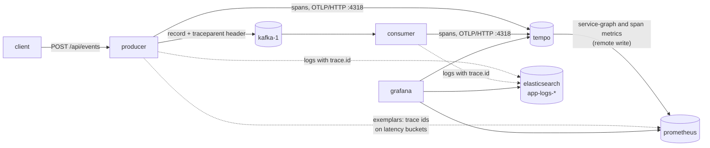

# Tracing: one request across both apps, in Grafana Tempo

*Step 08 of the ELK + Kafka + Grafana project · branch `step-08-tracing`*

**Goal:** follow a single request from the producer's HTTP API, through Kafka, into the consumer and on to a REST service, and connect it to its logs and metrics.

Logs (steps 04–06) show what each app did. Metrics (step 07) show how the system is doing overall. Neither answers *what happened to **this** request*: which app was slow, how long it sat in Kafka, which log lines belong to it. A **trace** does: every unit of work (a **span**) carries the same trace id, across processes, and Kafka carries the id from producer to consumer.

```text
producer  http post /api/events        ███████████████████████████████  25.6 ms
producer    app-events send                  ████████████████            14.1 ms
consumer      app-events process                              ██████      5.0 ms
```

Open the **Traces** dashboard in Grafana (http://localhost:3000/d/elk-kafka-grafana-traces), or **Explore → Tempo** (http://localhost:3000/explore) for free-form search, or jump in from a log line or a metric.

---

## 1. The big picture



| Piece | Role |
|-------|------|
| **Micrometer Tracing** + OpenTelemetry bridge, in both apps | Creates spans for HTTP requests, Kafka sends and `@KafkaListener` calls, and puts trace and span ids into the logs |
| **Kafka observation** | The producer adds a W3C `traceparent` header to each record; the consumer continues the trace from it |
| **Tempo** `grafana/tempo:2.8.2` | Stores the traces (24 h), builds the service graph and span metrics for Prometheus |
| **Grafana** | Shows traces, and links trace → logs (Elasticsearch), trace → metrics, metric → trace (exemplars) |
| **`MaskingObservationFilter`** (library) | Masks card and personal data in span attributes before export |

---

## 2. Tracing in the apps

Both apps depend on Spring Boot 4's OpenTelemetry starter:

```xml
<dependency>
    <groupId>org.springframework.boot</groupId>
    <artifactId>spring-boot-starter-opentelemetry</artifactId>
</dependency>
```

It brings Micrometer Tracing with the OpenTelemetry bridge and the OTLP exporter. Configuration:

```yaml
management:
  tracing:
    sampling:
      probability: 1.0                          # every request (lab); the default is 0.1
  opentelemetry:
    tracing:
      export:
        otlp:
          endpoint: ${OTLP_TRACING_ENDPOINT:http://localhost:4318/v1/traces}   # Compose: http://tempo:4318/v1/traces
  otlp.metrics.export.enabled: false            # the starter would also push metrics over OTLP:
  logging.export.otlp.enabled: false            #   metrics go to Prometheus, logs through Filebeat
```

| Setting | Why |
|---------|-----|
| `sampling.probability: 1.0` | Trace every request. In production, 1–10% is usual: tracing everything costs CPU, network and storage. |
| OTLP over HTTP to `:4318` | The standard OpenTelemetry protocol; Tempo receives it directly. Tempo's port 4318 is published, so apps run from the IDE send to `localhost:4318` by default. |
| OTLP metrics and logs **off** | The starter can also push metrics and logs over OTLP. This stack has its own paths for both. |

### What becomes a span

| Span | App | Created by |
|------|-----|-----------|
| `http post /api/events` (kind SERVER) | producer | Spring MVC: every HTTP request |
| `app-events send` (kind PRODUCER) | producer | `KafkaTemplate`, with `spring.kafka.template.observation-enabled: true` |
| `app-events process` (kind CONSUMER) | consumer | Each `@KafkaListener`, with `spring.kafka.listener.observation-enabled: true` |

`PciKafkaTemplate` sends through a normal `KafkaTemplate`, so the send span and the trace header come for free.

### Across Kafka

With observation on, the producer writes the trace context into a record header:

```text
traceparent: 00-842f92358f3a7e179cd5eba9ec3df68e-<span id>-01
```

The consumer's listener reads it and starts its span as a **child** of the send span, so both apps share one trace id. The step 03 decrypting interceptor copies the headers into the record it hands on, so the header survives.

### Not traced: `/actuator`

Prometheus scrapes `/actuator/prometheus` and blackbox-exporter calls `/actuator/health` every few seconds, which would bury real requests under thousands of useless traces. A small `ObservationPredicate` in each app ([producer](../springboot/producer/src/main/java/io/github/olgunyldz/producer/config/TracingConfig.java), [consumer](../springboot/consumer/src/main/java/io/github/olgunyldz/consumer/config/TracingConfig.java)) skips them:

```java
@Bean
ObservationPredicate noActuatorObservations() {
    return (name, context) -> !(context instanceof ServerRequestObservationContext request
            && request.getCarrier().getRequestURI().startsWith("/actuator"));
}
```

---

## 3. Masking in traces

Logs pass three masking layers (step 06). Without care, traces would have none. Spans carry no message bodies, but their attributes hold what the client sent, such as `http.url`.

The library now has a fourth gate: [`MaskingObservationFilter`](../springboot/log-masking/src/main/java/io/github/olgunyldz/logmasking/logging/tracing/MaskingObservationFilter.java). Spring Boot applies every `ObservationFilter` bean to every observation **before** it becomes a span or a metric tag. This one runs each key value through the same `SensitiveDataMasker` the logs use:

```text
POST /api/cards/4111111111111111   →   span http.url = /api/cards/************1111
```

It's registered by `ObservationMaskingAutoConfiguration` (listed in `AutoConfiguration.imports`), so adding the library is enough, and it's switched off together with log masking (`logging.masking.enabled=false`).

**Trace ids aren't masked in logs.** A 32-character hex trace id now and then contains 11 digits in a row, which the national-ID rule would check, and masking it would break the link from a log line to its trace. `MaskedLoggingEvent` leaves the MDC keys `traceId` and `spanId` alone.

---

## 4. Tempo

[monitoring/tempo.yml](../monitoring/tempo.yml): a single process, local disk, sized for a lab.

| Setting | Value |
|---------|-------|
| Receivers | OTLP HTTP `:4318`, gRPC `:4317` |
| Query API | `:3200` (Grafana uses it) |
| Retention | 24 hours (`compactor.compaction.block_retention`) |
| Storage | Local, in the `tempo-data` volume |
| Metrics generator | `service-graphs`, `span-metrics`, `local-blocks`, written to Prometheus by remote write |

The **metrics generator** turns spans into Prometheus metrics:

| Metric | Shows |
|--------|-------|
| `traces_service_graph_request_total{client, server, connection_type}` | Who calls whom: `user → producer`, `producer → consumer` (over `messaging_system`, Kafka) |
| `traces_spanmetrics_calls_total`, `traces_spanmetrics_latency_bucket` | Rate and duration per service and span name |

Prometheus accepts them because it now runs with `--web.enable-remote-write-receiver`.

---

## 5. Connecting logs, metrics and traces

### Logs → traces

Spring Boot puts `traceId` and `spanId` into every log line's MDC, and the ECS JSON from step 04 includes them. Logstash renames them to ECS's `trace.id` and `span.id`:

```json
{"message": "Received for app-events: key=order-1001 …", "service": {"name": "producer"},
 "trace": {"id": "842f92358f3a7e179cd5eba9ec3df68e"}, "span": {"id": "c52b61087b09545a"}}
```

All log lines of one request, from both apps, in Kibana (*App logs*):

```text
trace.id : "842f92358f3a7e179cd5eba9ec3df68e"
```

### Traces → logs, traces → metrics

The Grafana *Tempo* data source ([monitoring/grafana/provisioning/datasources/tempo.yml](../monitoring/grafana/provisioning/datasources/tempo.yml)) links every span to:
- **Logs:** a new *App logs* Elasticsearch data source (`app-logs-*`), queried with `trace.id:"<trace id>"`. Grafana now joins the `data-layer` network to reach Elasticsearch.
- **Metrics:** the service's HTTP request rate in Prometheus.
- **Service map:** drawn from Tempo's service-graph metrics (Explore → Tempo → *Service Graph*).

### Metrics → traces: exemplars

An **exemplar** is one sampled request's trace id, stored next to a metric sample. The producer exports them on its HTTP latency histogram:

```yaml
management.metrics.distribution.percentiles-histogram.http.server.requests: true   # producer
```

| Piece | Setting |
|-------|---------|
| App | Histogram buckets for `http.server.requests`; Spring Boot attaches the trace id of sampled requests |
| Prometheus scrape | `scrape_protocols: [OpenMetricsText1.0.0, …]` for the apps: exemplars only exist in the OpenMetrics format |
| Prometheus | `--enable-feature=exemplar-storage` |
| Grafana data source | `exemplarTraceIdDestinations: trace_id → tempo` |

The *Kafka Producer* dashboard has a new panel, **Response time p95, with traces**. Each dot is one request: hover over it and choose *Query with Tempo* to open that request's trace.

---

## 6. The Traces dashboard

**Grafana → Dashboards → Kafka → Traces** (http://localhost:3000/d/elk-kafka-grafana-traces). Filters at the top: **Service** and **Operation** (span name); `/actuator` spans never count.

| Row | Panels | Source |
|-----|--------|--------|
| **Overview** | Requests/s, spans/s, error rate, p95 request time, Kafka records processed/s, p95 consumer processing (5-minute windows) | Tempo's span metrics in Prometheus |
| **Service map** | The map `user → producer → consumer`, next to a **Call paths** table: from, to, via (`messaging_system` = Kafka), calls/s, p95 time | Tempo service map; service-graph metrics |
| **Traces** | **Recent traces**, **Slowest traces** (over 100 ms), **Traces with errors**, **Traces through Kafka**. Click a trace ID to open its waterfall | Tempo, TraceQL |
| **Spans** | Spans/s and p95 duration per operation, HTTP p50/p95/p99, errors/s per operation | Span metrics |
| **Kafka hop** | Records/s producer → consumer, send vs. processing time (p95), Kafka spans/s per topic | Service-graph and span metrics |

The TraceQL behind the trace tables:

| Table | TraceQL |
|-------|---------|
| Recent | `{ resource.service.name =~ "$service" && name !~ "http get /actuator.*" }` |
| Slowest | `{ resource.service.name =~ "$service" && traceDuration > 100ms }` |
| With errors | `{ resource.service.name =~ "$service" && status = error }` |
| Through Kafka | `{ span.messaging.system = "kafka" }` |

Tempo returns the first matches it finds, not necessarily the newest, so each table asks for 100 traces and sorts them by start time. The dashboard's **Explore traces** link opens Tempo's search for anything the tables don't cover.

---

## 7. A third service, and two consumer replicas

To see a trace cross more than one hop, the consumer now calls a new REST service for every record it handles, and runs as **two replicas**.

```text
producer     SERVER    http post /api/events
producer     PRODUCER    app-events send
consumer     CONSUMER      app-events process          (on one of the two replicas)
consumer     CLIENT          http post                 → message-api
message-api  SERVER            http post /api/messages
```

### message-api

A new Spring Boot module, [springboot/message-api](../springboot/message-api), on port **8084**:

| | |
|---|---|
| Endpoint | `POST /api/messages`, answers `202` with `{"ackId", "receivedAt", "status": "RECEIVED"}` |
| Does | Logs the notice at INFO and acknowledges it |
| Request | `{"topic", "partition", "offset", "key", "type", "consumerGroup", "handledBy"}` |
| Has | The `log-masking` library (log and span masking), Actuator and Prometheus, tracing; no Kafka |

```text
Message received from 1c1848c48871 (event-consumer): app-events partition 0 offset 56 key=order-rest-1 type=PaymentAuthorized
```

**What the consumer sends, and what it doesn't.** The listeners hold the record **decrypted** (step 03). Forwarding the value would carry card and personal data to yet another service and its logs. So the notice describes the record (where it was in Kafka, its key and type, which group and replica handled it), never its content.

### The consumer calls it

[`MessageApiClient`](../springboot/consumer/src/main/java/io/github/olgunyldz/consumer/client/MessageApiClient.java) is built from Spring Boot's `RestClient.Builder` (`spring-boot-starter-restclient`). Because Spring Boot builds it, every call gets a client span and the `traceparent` header, so the trace continues into message-api without any tracing code. Each listener calls it after logging the record:

```java
messageApi.notify(record, event.type(), groupId);
```

| Setting | Value |
|---------|-------|
| `app.message-api.url` | `${MESSAGE_API_URL:http://localhost:8084}`; Compose: `http://message-api:8084` |
| `spring.http.clients.connect-timeout` / `read-timeout` | 2 s / 3 s: a slow API must not stall the listener threads |
| On failure | Logged as a warning and swallowed: the record is already handled, and a down API must not make Kafka redeliver it. The failed call still shows as an error span. |

### Two consumer replicas

```yaml
consumer:
  deploy:
    replicas: 2
  ports:
    - "8082-8083:8082"          # one host port per replica
  depends_on:
    message-api: { condition: service_healthy }
```

| Consequence | Handled by |
|-------------|------------|
| No fixed `container_name` (it must be unique): the containers are `elk-kafka-grafana-consumer-1` and `-2` | Inside Docker the service name `consumer` resolves to both |
| Each consumer group now has members on both replicas | Kafka splits the 3 partitions between them, e.g. partition 0 on one replica, 1 and 2 on the other. 2 replicas × 3 listener threads = 6 members for 3 partitions, so 3 threads per group stay idle; more partitions would put them to work |
| Prometheus can't scrape a fixed `consumer:8082` (it would hit one replica at random) | `dns_sd_configs` for `consumer`: every replica becomes its own target, labelled by IP |
| Filebeat matched `container.name: consumer` | Filebeat matches the Compose service label (`docker.container.labels.com.docker.compose.service`) instead, and `service.compose` is copied from that label, the same for both replicas |
| Which replica handled a record | `handledBy` (the replica's host name) in the notice and message-api's log; `container.name` in Kibana |

In one run, 36 records were split 16 / 20 between the replicas, and message-api received all 36 notices with no failed calls.

---

## 8. Things to try

| Do | See |
|----|-----|
| Send a few samples from http://localhost:8081, then open the *Traces* dashboard | Rates and p95s move, the requests appear under *Recent traces*; click one for its waterfall |
| Explore → Tempo → *Search*, service `producer` | The same traces, with free-form filters |
| In the trace, open a span → *Logs for this span* | The app log lines of this request, from both apps |
| Explore → Tempo → *Service Graph* | `user → producer → consumer` with request rates |
| *Kafka Producer* dashboard → *Response time p95, with traces* | Dots; click one to open its trace |
| Kibana, *App logs*: `trace.id : "<id>"` | The same request's log lines in Kibana |
| `docker compose stop consumer`, send, wait, start it | The trace's consumer span starts much later than the send: time spent waiting in Kafka |
| `POST /api/anything/4111111111111111` | A 404 trace whose `http.url` reads `/api/anything/************1111` |
| `docker compose logs message-api` while sending | One line per record, from both consumer replicas (`Message received from <host>`) |
| `docker compose stop message-api`, send, start it | Consumer warnings `message-api call failed`; the client span turns into an error under *Traces with errors*; records are still handled |
| `docker compose up -d --scale consumer=3` | Partitions spread over three replicas: `kafka-consumer-groups.sh --describe --group event-consumer` (add a host port, or drop the port range, first) |

---

## 9. Corrections to earlier articles

The earlier articles describe their own step and are left unchanged. On this branch, these statements are out of date:

| Earlier article says | Now |
|----------------------|-----|
| Step 07, dashboards: `spring_kafka_template_seconds` / `spring_kafka_listener_seconds` have the tags `result`, `exception`, `name` | With Kafka observation on, they have `error` (`none` on success) and `spring_kafka_listener_id` instead. 11 dashboard queries were rewritten, and two panels renamed (*Failures by error type*, *Failed sends by error type*). |
| Step 07: the apps' `/actuator/*` requests show up in HTTP metrics | They're no longer observed: no traces and no `http_server_requests` for `/actuator`. |
| Step 04, ECS logs: the fields are `@timestamp`, `log.*`, `process.*`, `service.*`, `message`, `ecs` | Plus `traceId` and `spanId` in the app's output, which become `trace.id` / `span.id` in `app-logs-*`. |
| Step 04: `MaskedLoggingEvent` masks every MDC value | Except `traceId` and `spanId`. |
| Step 03, the library's beans | Plus `MaskingObservationFilter`, through `ObservationMaskingAutoConfiguration`. 155 library tests. |
| Step 07: Grafana has the Prometheus data source and runs on `service-layer` | It also has *Tempo* and *App logs* (Elasticsearch), and joins `data-layer` too. |
| Step 07: Prometheus runs with the image's default flags | Plus `--enable-feature=exemplar-storage` and `--web.enable-remote-write-receiver`; the app scrape prefers OpenMetrics. |
| Step 07: published ports | Plus 4318 (Tempo OTLP/HTTP). |
| Step 07: five dashboards | Six: plus **Traces**. |
| Step 02–07: one consumer container named `consumer`, host port 8082 | Two replicas, `elk-kafka-grafana-consumer-1` / `-2`, host ports 8082 and 8083; `docker compose logs consumer` shows both. Plus a new service, `message-api` (port 8084). |
| Step 02–07: the listeners only log the record | They also call message-api over REST (`MessageApiClient`). The consumer depends on `spring-boot-starter-restclient`. |
| Step 04–07: Filebeat finds the apps by `container.name`, and `service.compose` = container name | By the Compose service label, for producer, consumer and message-api; `service.compose` comes from that label. |
| Step 07: Prometheus scrapes `producer:8081`, `consumer:8082` | `producer:8081`, `message-api:8084`, and each consumer replica found through DNS (`dns_sd_configs`); a health probe for message-api. |
| Step 02–03: log lines name a record as `topic-partition@offset` (`Skipping app-logs-2@1 …`, `Can't decrypt …`) | `topic partition N offset M`. Since step 04's masking, `app-logs-2@1` looked like an email address and became `a***@1`. |

---

## 10. What we checked

| Check | Result |
|-------|--------|
| One `POST /api/events` | One trace with 3 spans across both apps: `http post /api/events` → `app-events send` → `app-events process` |
| Logs of a trace | Producer and consumer log lines found in `app-logs-*` by `trace.id`, each with its own `span.id` |
| Grafana | *Prometheus* and *App logs* data sources healthy; Tempo search returns traces; the trace view draws the 3-span waterfall |
| Exemplars | Over 160 in Prometheus, each with `trace_id` and `span_id` |
| Service graph | `user → producer`, `user → consumer`, `producer → consumer` (`messaging_system`) |
| `/actuator` noise | After the predicate, only real requests are traced |
| Span masking | `POST /api/cards/4111111111111111` → `http.url = /api/cards/************1111`; no card or email from any sample in any trace |
| Dashboards | Every query returns data, except the failure panels (nothing failed) and *Apps on your machine* (local targets off) |
| Library tests | 155 passing (filter, auto-configuration, trace ids in MDC) |
| Prometheus targets | 19 of 19 up (with Tempo's health probe) |
| Memory | 5.0 GB in total; Tempo about 250 MB |
| message-api and 2 consumer replicas | One request → 5 spans in 3 services (producer, consumer, message-api); partitions split across both replicas; 36 records → 16 + 20 per replica, all 36 notices received, 0 failed calls; Prometheus scrapes both replicas (22 of 22 targets up); `app-logs-*` has consumer (both containers), producer and message-api |
| *Traces* dashboard | Every span-metric query returns data (except errors: nothing failed); the trace tables list recent, slow (27 over 100 ms in an hour) and Kafka traces; *Call paths* shows producer → consumer via `messaging_system` with p95. The service map's layout didn't finish in the headless browser used for screenshots; its data is the same as the *Call paths* table |

---

## 11. Limits

- **100% sampling.** Fine for a lab, too much for real traffic. Lower `management.tracing.sampling.probability`, or sample in a collector (tail sampling keeps all errors and slow requests).
- **24 hours of traces**, on local disk, one Tempo process. Real setups use object storage (S3, GCS) and more retention.
- **No OpenTelemetry Collector.** Apps send straight to Tempo. A collector in between adds batching, retries, tail sampling and the freedom to switch backends.
- **Only HTTP and Kafka are traced.** There's no database here; JDBC, HTTP clients and other libraries would need their own instrumentation.
- **Logstash and Filebeat aren't traced.** The trace ends at the consumer; the path of a log line through Filebeat → Kafka → Logstash doesn't show up.
- **Idle consumer threads.** 2 replicas × 3 threads per group for 3 partitions: half of them wait. Lower the concurrency or add partitions.
- **The blackbox health check for `consumer` hits one replica**, whichever DNS returns. Prometheus scrapes both, so *Stack Health*'s scrape-target table shows each one.
- **The span masking only sees key values.** Span events or attributes added by other instrumentation, outside Micrometer Observation, don't go through the filter.

---

## Next step

Logs, metrics and traces are all in place and linked. A natural next step is **alerting**: rules in Grafana for consumer lag, failing services, error rates and slow traces, sent where someone will notice.
